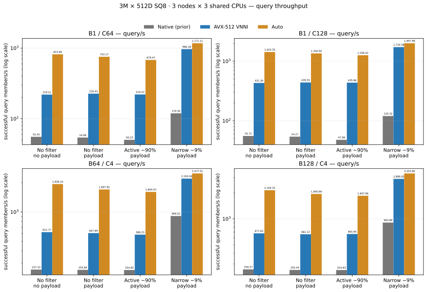

# Qdrant 1.20.0 with Veortex: shared-CPU SQ8 results

This page shows the latest complete 3-node, 3-CPU-per-node flat-SQ8 matrix. Each node had a disjoint three-CPU mask; scan, TopK, FP32 reranking, payload, and service workers shared that mask with no per-thread affinity. These are selected end-to-end load points, not maximum-capacity or scan-only scaling claims.

Qdrant provides the API, shard routing, storage, and cluster management. For eligible flat SQ8 searches, the per-shard Veortex ring lets concurrent queries share gallery reads. Scan/score work feeds separate TopK, FP32 reranking, and payload-support stages; those worker threads remain free to run on the same three CPUs as scan and service work.

The fixture contains 3,000,000 512D cosine vectors in three one-million-point shards, SQ8 quantization, replication factor 1, HNSW disabled, and all three payload indexes. Payload metadata is present on every point in every category, including requests with `with_payload=false`; that flag only changes what is returned. Requests return ordered Top10 results; SQ8 rescoring uses a cap of 12 candidates per segment (oversampling 1.2) before FP32 rescore. This is the measured profile, not a universal candidate setting. Each category's same 1,024 saved queries are used for accuracy checks and timed cells, with no held-out query set; both fresh backends matched ordered FP32 Top10 at score tolerance 1e-6 on these queries, which does not guarantee exact results on other queries. The historical fixture seed is unknown: public generation helpers produce comparable data, not byte-identical gallery and query artifacts. The four categories below show payload selection and approximate filter eligibility explicitly.

Campaign `runtime-limits-fullmatrix-20261110t110031z` finished 2026-11-10 UTC. All **32/32 fresh Veortex cells** passed the row gates. The independent accuracy checks passed **8/8 × 1,024 queries**; across timed fresh rows, **865,216 HTTP requests** returned **2,406,382 exact-query matches**, with no failed requests or queries. The original three nodes were restored healthy; immutable lower metadata was unchanged; overlays were removed before restart.

The host was reported as an Intel Xeon Silver 4510 VM with 16 guest vCPUs and 47.04 GiB RAM. This records guest-visible allocation; physical-core isolation and physical cache topology were not established. The three node masks were `4,5,6`, `7,8,9`, `10,11,12`, each with a three-vCPU quota.

Each cell used 16 validated warmup requests, then a 60-second dispatch window and final drain. HTTP req/s is successful requests divided by actual elapsed time; query/s is successful query members divided by the same elapsed time. Both rates include drain. Latency is full-response p95/p99 in milliseconds.

Fresh candidate source: `0aa62c281b7262368ca6f1ed69de71647be10ac0`; ELF SHA-256: `074f45b364a8e80da3fb9307d637812072fd755f56b91aeb8bdd4bf92b1ba60d`. The same Go client SHA-256 `5477653066b11acf0ce1f53545f6bd98aad9175ed3c4072a89b051298e05cde0` was used across arms. The candidate passed the frozen focused collection and quantization build-test selection. Exact source-module checks cover 22 cases; this is not a full workspace test claim.

## Results

Each cell is **HTTP requests/s / query members/s; full-response p95/p99 ms**. B1 has equal request and query rates; batched B64/B128 do not. Lower latency is better.

### No filter / no payload

| Batch / concurrency | Native Qdrant 1.20 (prior H0 reference) | Veortex AVX-512 VNNI | Veortex Auto |
|---|---:|---:|---:|
| B1 / C64 | 55.43 / 55.43; 1,546.88 / 1,881.56 | 219.51 / 219.51; 308.25 / 315.82 | 815.96 / 815.96; 89.44 / 104.16 |
| B1 / C128 | 55.71 / 55.71; 2,461.91 / 2,854.50 | 431.34 / 431.34; 311.30 / 334.81 | 1,424.35 / 1,424.35; 108.68 / 122.30 |
| B64 / C4 | 4.02 / 257.33; 1,078.83 / 1,261.08 | 9.72 / 621.77; 468.60 / 532.00 | 30.13 / 1,928.10; 164.96 / 181.35 |
| B128 / C4 | 2.03 / 259.37; 2,419.23 / 2,990.62 | 5.29 / 677.63; 870.25 / 911.16 | 16.75 / 2,144.32; 304.56 / 335.57 |

### No filter / payload

| Batch / concurrency | Native Qdrant 1.20 (prior H0 reference) | Veortex AVX-512 VNNI | Veortex Auto |
|---|---:|---:|---:|
| B1 / C64 | 54.08 / 54.08; 1,375.51 / 1,662.05 | 226.43 / 226.43; 300.08 / 311.86 | 753.17 / 753.17; 96.86 / 108.24 |
| B1 / C128 | 54.27 / 54.27; 2,899.84 / 3,734.77 | 439.35 / 439.35; 316.45 / 366.33 | 1,350.94 / 1,350.94; 117.79 / 136.22 |
| B64 / C4 | 4.00 / 255.84; 1,260.06 / 1,418.92 | 9.50 / 607.89; 469.12 / 490.06 | 26.53 / 1,697.95; 186.96 / 211.18 |
| B128 / C4 | 2.00 / 255.44; 2,520.61 / 2,965.36 | 5.17 / 661.12; 873.23 / 1,000.88 | 15.16 / 1,940.89; 333.65 / 359.62 |

### Active only (~90%) / payload

| Batch / concurrency | Native Qdrant 1.20 (prior H0 reference) | Veortex AVX-512 VNNI | Veortex Auto |
|---|---:|---:|---:|
| B1 / C64 | 50.23 / 50.23; 1,386.95 / 1,677.05 | 220.53 / 220.53; 314.75 / 331.97 | 679.47 / 679.47; 113.02 / 126.65 |
| B1 / C128 | 47.99 / 47.99; 2,974.24 / 3,420.46 | 435.96 / 435.96; 313.90 / 326.81 | 1,256.52 / 1,256.52; 129.97 / 149.43 |
| B64 / C4 | 3.98 / 254.82; 1,293.28 / 1,409.85 | 9.16 / 586.23; 532.95 / 588.20 | 25.07 / 1,604.43; 192.18 / 208.10 |
| B128 / C4 | 1.99 / 254.83; 2,404.76 / 2,658.87 | 5.20 / 665.94; 851.02 / 930.17 | 14.43 / 1,847.66; 352.50 / 385.05 |

### Active + position exclusion (~9%) / payload

| Batch / concurrency | Native Qdrant 1.20 (prior H0 reference) | Veortex AVX-512 VNNI | Veortex Auto |
|---|---:|---:|---:|
| B1 / C64 | 119.30 / 119.30; 601.67 / 669.96 | 966.18 / 966.18; 77.36 / 86.69 | 1,171.11 / 1,171.11; 65.48 / 70.62 |
| B1 / C128 | 120.32 / 120.32; 1,261.05 / 1,473.20 | 1,720.58 / 1,720.58; 97.94 / 107.50 | 1,997.98 / 1,997.98; 90.96 / 104.65 |
| B64 / C4 | 14.21 / 909.52; 346.82 / 386.55 | 34.27 / 2,193.04; 137.37 / 146.61 | 38.70 / 2,477.01; 122.52 / 133.21 |
| B128 / C4 | 7.06 / 903.89; 685.52 / 733.47 | 22.65 / 2,899.02; 215.94 / 237.82 | 26.20 / 3,353.80; 184.37 / 202.46 |

*Successful query members/s by backend. Bar labels show query/s to two decimals; the y-axis uses a logarithmic scale. Native is the earlier H0 reference.*

## Interpretation and provenance

Native values are the 16 accepted H0 measurements under the same three-shared-CPU workload contract and query corpus; they were **not rerun in this campaign** and are cross-run references. AVX-512 VNNI and Auto cells are fresh candidate measurements. Native compiler flags were not recovered or matched to the local Veortex build; the official native executable and locally built candidate also use different compiler/linker toolchains. These are finite observations from one shared VM and do not establish statistical significance, long-duration stability, production capacity, or a pure kernel-speedup claim.

This single-collection matrix does not measure multi-collection fairness or write/recovery behavior. The candidate retains a configurable admission policy historically named `max_collections_per_core`, default 3; in shared mode that cap applies to the shared coordinator bucket, rather than to each physical CPU. It does not limit this one-collection workload, but can backpressure a fourth simultaneously active collection.

The measured local candidate used Rust 1.98.0 with the release profile, opt-level 3, fat LTO, one codegen unit, and debug information disabled. The official native binary's effective compiler flags are unknown. See the [build flags and CPU acceleration notes](benchmarks/BUILD_FLAGS_AND_CPU_ACCELERATION.md) for the limits of the build comparison.

The measured candidate (`074f45b364a8e80da3fb9307d637812072fd755f56b91aeb8bdd4bf92b1ba60d`) is not the downloadable V45.1 archive. The current V45.1 Linux x86_64 release is available at the [V45.1 release page](https://github.com/nicabreon/qdrant-veortex-releases/releases/tag/v1.20.0-veortex.v45.1.20261109); its executable SHA-256 is `90d54aeabbaa17350b94161f6a7926528b13452b0b50296f0bc45fc0e96969e0`. That is an earlier binary, not the ELF used for the matrix above. The native H0 reference is official stock Qdrant 1.20.0, SHA-256 `5081acd073ef29701415dc2d1655d98750be8c08008541febc20cf2935800f2f`.

Detailed accepted/rejected row diagnostics, exact per-node route/CPU/ISA evidence, and the full curation are in the [report](benchmarks/runtime-limits-20261110.md), [JSON](benchmarks/runtime-limits-20261110.json), and [CSV](benchmarks/runtime-limits-20261110.csv). Curated JSON input SHA-256: `4e947f3cdbd4065ac67d795cfa2896e558437aed2e039b232345af09ba6d670b`.

The public [reproduction guide](reproduce/README.md), [matrix runner](reproduce/run-batch-matrix.py), and [accuracy checker](reproduce/verify-accuracy.py) document workload preparation and earlier releases. To repeat these exact latest measurements requires the matching candidate ELF and runtime configuration identified above, the current [batch-matrix protocol](reproduce/BATCH_MATRIX_PROTOCOL.md), and the same saved query/truth artifacts; the downloadable V45.1 binary is an earlier build and does not reproduce this candidate. Earlier revisions and results are preserved in the [verbatim README archive](README.archive-20261110.md), which retains links to the V45/V45.1 studies, prior CPU-policy and dynamic-ring runs, the original failed rows, and their reports.

[`LICENSE`](LICENSE) and [`NOTICE`](NOTICE) describe the public helper and dependency scope. See [third-party notices](third_party/THIRD_PARTY_NOTICES.md), the [license audit](third_party/license-audit.json), and [source availability](third_party/SOURCE-AVAILABILITY.md). The repository publishes binary research builds and reproduction helpers, not Qdrant or Veortex engine source.
