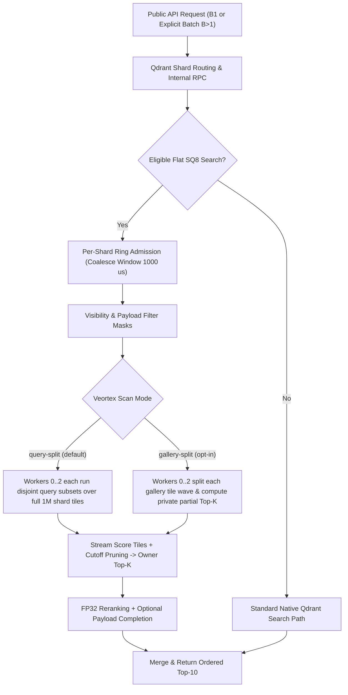

# Qdrant 1.20.0 with Veortex: Shared-CPU Flat Quantized Vector Search

This repository publishes **binary-only research builds** of Qdrant 1.20.0 integrated with Veortex in-process flat quantized search kernels, alongside reproducible benchmark runners, runtime profiles, and verified head-to-head results.

---

## What is Qdrant + Veortex?

**Qdrant + Veortex is not a separate vector database or an external sidecar.** Qdrant remains the database and cluster manager in full: its HTTP/gRPC API, collections, shard routing, Raft consensus, WAL, replication, payload indexes, filtering semantics, snapshot/recovery lifecycle, and storage formats stay intact inside a single `qdrant` binary.

Veortex acts as an **in-process execution engine** for eligible flat quantized searches (`exact=false` quantized flat scan + FP32 rescore, with HNSW disabled):

- Any non-flat or ineligible query routes automatically through standard Qdrant execution.
- No vectors are duplicated on disk and no second storage engine is maintained.
- Cooperative gallery scanning adds zero persistent storage overhead; it only changes how scan workers share memory reads and partial Top-K state during execution.

| Layer | Native Qdrant 1.20.0 (`222b2e44`) | Qdrant + Veortex (`afbe2437b`) |
|---|---|---|
| **Database & cluster** | Standard Qdrant storage, Raft, WAL, shard routing | Identical — Qdrant owns all state, routing, and API |
| **Request scheduling** | Independent per-request search; `BatchFilteredSearcher` shares reads within a single explicit `B>1` batch | Per-shard coalescing ring (`query-split`) or cooperative tile workers (`gallery-split`) sharing gallery reads *across* concurrent HTTP requests and batches |
| **Quantized scoring** | Upstream scalar/SIMD scorers | Cache-tiled multi-query kernels (`Auto`: Intel AMX + AVX-512 VNNI) |
| **Top-K, rescore & payload** | Sequential search closure on search threads | Streaming score tiles to owner-keyed Top-K with conservative cutoff pruning, FP32 reranking, and overlapped payload completion (`SEPARATE_TOPK=1`) |
| **CPU budget (benchmark contract)** | 3 shared vCPUs per node, no per-thread pinning | Same 3 shared vCPUs per node (`NanoCpus=3e9`), no per-thread pinning |

---

## Execution Modes & Request Flow

### Query-Split vs Gallery-Split

Suppose a shard holds **1,000,000 gallery vectors** on a node with **3 scan workers** sharing 3 vCPUs:

1. **`veortex_query` (`query-split`, default):**
   - Incoming concurrent `B1` requests and explicit batches join active lanes in the per-shard ring. Each worker takes a group of compatible queries and scans the shard's gallery tiles once across all queries in that group simultaneously.
   - **Strength:** At moderate-to-high concurrency (`C16–C512`), workers operate largely independently without inter-worker Top-K merge overhead per tile, achieving maximum memory-bandwidth amortization across dozens of concurrent queries.
2. **`veortex_gallery` (`gallery-split`, `QDRANT_VEORTEX_SCAN_MODE=gallery`, `WORKERS=3`, `PRIVATE_TOPK=1`):**
   - Cooperative scan workers (`veortex-scan-0..2`) divide each visible gallery tile wave across all 3 workers, accumulate partial candidates in worker-private Top-K buffers, and merge into the query owner's Top-K before FP32 reranking.
   - **Expected trade-off:** Aims to reduce per-request latency and parallelize scans across all 3 workers even when few concurrent query groups are active (low concurrency / small batches), while incurring worker coordination and private Top-K merge overhead as request concurrency climbs.

### Why Veortex Scales Higher Than Native Qdrant Here

In flat (non-HNSW) quantized search over 1M vectors per shard, **reading quantized vectors from RAM/L3 dominates execution time**:

- **Independent `B1` memory bottleneck in Native:** Concurrent `B1` requests trigger independent scans that repeatedly stream the same 1M vectors through CPU memory bandwidth and saturate 3 shared vCPUs (~`54–57` req/s unfiltered plateau, pushing C512 p99 latency above `10 s`).
- **Cross-request coalescing + multi-query kernels in Veortex:** By grouping compatible concurrent queries in the ring, each gallery tile fetched into L1/L2 cache scores multiple queries in one pass using dense multi-query AVX-512 VNNI or Intel AMX matrix instructions, while conservative Top-K cutoff pruning skips unnecessary work and separate Top-K/FP32-rerank/payload threads overlap remaining stages.
- **Trade-off at isolated C1:** With only `concurrency=1`, there are no concurrent requests to coalesce across HTTP connections, so Native's direct path can slightly lead Veortex's ring/coalescing handoff (`19.64` vs `17.15` req/s unfiltered).

---

## Latest Benchmark Campaign — 16 November 2026 (`RUNNING`: `94/135` B1 Cells)

> **Status:** Active matched-resource head-to-head campaign on **3M × 512D SQ8 Cosine** comparing **Native Qdrant 1.20.0** (`45/45` complete) vs **Veortex `query-split`** (`45/45` complete) vs **Veortex `gallery-split`** (`4/45` recorded so far; all `15/15` pre-timing 1,024-query FP32 accuracy gates passed), followed by a **`B2..B128` at `C4/C6`** (`210` cells) batch campaign. Full analysis and exact `d2223c8a4` release download archive (`v1.20.0-veortex.query-gallery.20261116`) will be published once validation completes.

- **Live Full Tables (All 5 Categories × C1–C512):** [benchmarks/native-query-gallery-20261116.md](benchmarks/native-query-gallery-20261116.md) ([JSON](benchmarks/native-query-gallery-20261116.json) | [CSV](benchmarks/native-query-gallery-20261116.csv))
- **Node Environment Profiles:** [Query-split profile](configs/query-gallery-query-20261116.env.example) | [Gallery-split profile](configs/query-gallery-gallery-20261116.env.example)

### Tested Arms & Binaries

| Arm | Executable SHA-256 | Source Commit | Mode / Config |
|---|---|---|---|
| **Native Qdrant 1.20.0** | `5081acd073ef29701415dc2d1655d98750be8c08008541febc20cf2935800f2f` | `222b2e44ab1c3f17e8246396ead6558e45041df7` | Native flat SQ8 + FP32 rescore (`MAX_SEARCH_THREADS=3`, `RAYON_NUM_THREADS=3`) |
| **Veortex `query-split`** | `d2223c8a48f9b65bcb59196d421fa00ded9488002975afc624990568be2be746` | `afbe2437b0ed3ddb533bfaae1c77d6bbc66d68c7` | Default ring (`MAX_RING_WORKERS=3`, `SEPARATE_TOPK=1`) |
| **Veortex `gallery-split`** | Same `d2223c8a4` ELF | `afbe2437b0ed3ddb533bfaae1c77d6bbc66d68c7` | Cooperative scan (`SCAN_MODE=gallery`, `WORKERS=3`, `PRIVATE_TOPK=1`) |

### Measured B1 Highlights (`94/135` Accepted, `0` Failed, `0` Rejected)

Each cell reports **HTTP req/s; p95 / p99 ms** (`30s` closed-loop dispatch + full drain, `16` warmups, exact FP32 oracle Top-10 match `<= 1e-6`, payload verified). All 5 categories are complete for both `native_120` and `veortex_query`; `veortex_gallery` is actively running:

| Category | Concurrency | Native 1.20 (`native_120`) | Veortex `query-split` (`veortex_query`) | Veortex `gallery-split` (`veortex_gallery`) |
|---|---:|---:|---:|---:|
| **No filter / no payload** | C1 | 19.64; 57.11 / 78.69 | 17.15; 67.03 / 85.35 | **24.07**; 43.66 / 44.80 |
| **No filter / no payload** | C4 | 56.13; 95.30 / 105.64 | 65.07; 77.06 / 90.24 | **85.71**; 50.10 / 51.52 |
| **No filter / no payload** | C16 | 56.97; 326.79 / 395.98 | 259.97; 71.60 / 82.99 | **313.27**; 55.46 / 58.58 |
| **No filter / no payload** | C32 | 55.99; 658.49 / 787.06 | 482.81; 81.03 / 96.49 | **509.19**; 68.26 / 72.71 |
| **No filter / no payload** | C512 | 54.71; 10,626.71 / 11,130.64 | **2,052.28**; 343.91 / 395.04 | pending |
| **Payload only** | C1 | **19.72**; 52.76 / 69.69 | 18.32; 59.70 / 72.53 | pending |
| **Payload only** | C512 | 54.01; 9,828.86 / 13,944.50 | **1,828.83**; 420.93 / 468.93 | pending |
| **Active ~90% / no payload** | C512 | 48.78; 12,477.39 / 12,805.77 | **1,926.19**; 414.00 / 506.74 | pending |
| **Active ~90% + payload** | C512 | 48.16; 11,105.92 / 12,572.95 | **1,799.65**; 422.24 / 473.47 | pending |
| **Active + pos + excl (~9%)** | C512 | 114.69; 4,595.74 / 5,094.40 | **3,126.79**; 259.83 / 335.94 | pending |

Notice the initial low-concurrency signal on `No filter / no payload`: `veortex_gallery` (`24.07` / `85.71` / `313.27` / `509.19` req/s at C1/C4/C16/C32) outperforms both Native (`19.64` / `56.13` / `56.97` / `55.99`) and `veortex_query` (`17.15` / `65.07` / `259.97` / `482.81`) with roughly half the p99 latency at C1–C16. Full C1–C512 results across all 5 categories are in [benchmarks/native-query-gallery-20261116.md](benchmarks/native-query-gallery-20261116.md).

---

## Fairness Contract & Limitations

- **Equal Guest Resources:** Three Docker nodes (`4,5,6`, `7,8,9`, `10,11,12`), `NanoCpus=3,000,000,000` (3 vCPUs/node), zero per-thread CPU pinning on any arm. Every scan, Top-K, rerank, payload, and HTTP thread shares the 3 node CPUs.
- **Unmatched Compiler Flags:** Official upstream Native Qdrant 1.20.0 (`5081acd0...`) vs local Rust 1.98 LTO release build (`d2223c8a4...`). Throughput differences include both algorithmic/scheduling differences and compiler/ISA differences.
- **Scope Caveats:** Measurements run on a shared KVM Xeon Silver 4510 VM over 3M × 512D SQ8 Cosine with `hnsw_m=0`, Top-10, 12-candidate rescore (`oversampling=1.2`), and finite 1,024-query/category cohorts (`15 × 1,024` accuracy gates passed pre-timing across all 3 arms). Results do not establish HNSW speedups, write-heavy throughput, or universal FP32 equivalence on unseen queries.

---

## Documentation, Reproduction & Archives

- **Architecture & Protocols:** [Qdrant Native vs Veortex](docs/QDRANT_NATIVE_VS_VEORTEX.md) | [Batch Matrix Protocol](reproduce/BATCH_MATRIX_PROTOCOL.md) | [Manual Deployment Guide](DEPLOYMENT.md) | [Reproduction Helpers](reproduce/README.md)
- **Prior Reports & Releases (Historical):** [11 Nov 2026 README Archive](README.archive-20261111.md) | [10 Nov 2026 README Archive](README.archive-20261110.md)
- **Licensing:** Binary research distribution only (Qdrant/Veortex engine source not included). See [LICENSE](LICENSE), [NOTICE](NOTICE), [third_party/THIRD_PARTY_NOTICES.md](third_party/THIRD_PARTY_NOTICES.md), [third_party/license-audit.json](third_party/license-audit.json), and [third_party/SOURCE-AVAILABILITY.md](third_party/SOURCE-AVAILABILITY.md).
