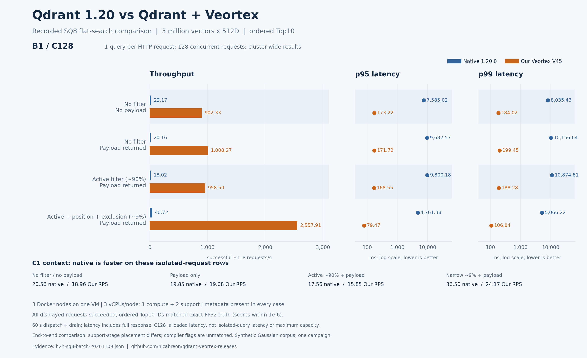
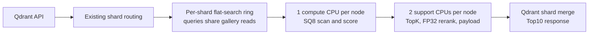
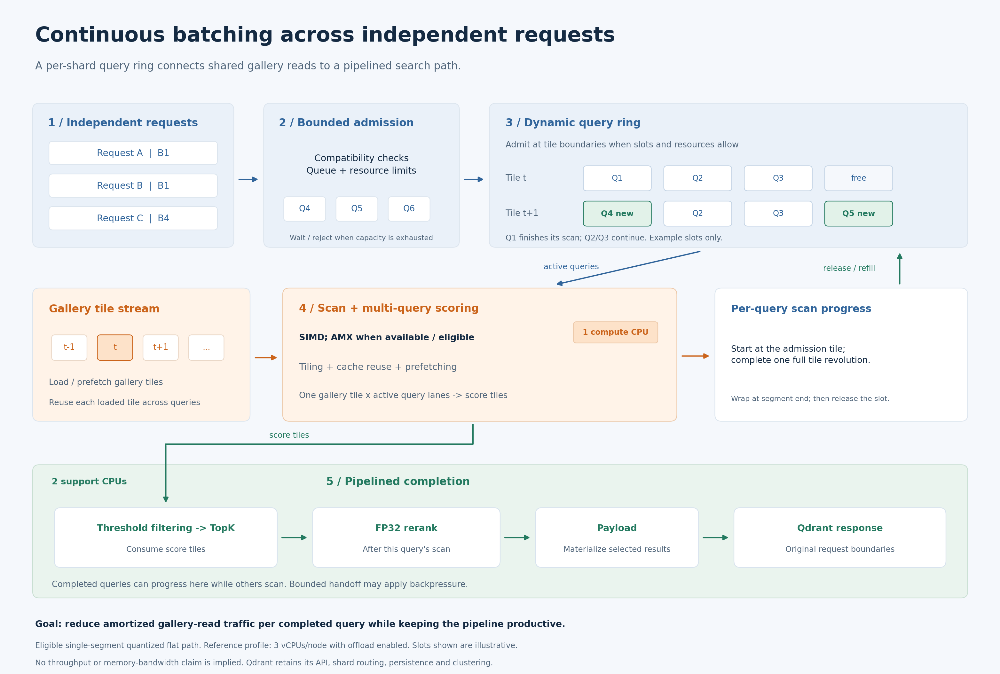
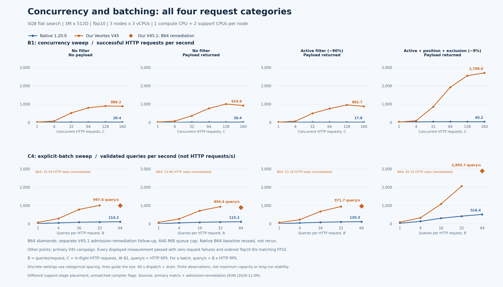

# Qdrant 1.20.0 with Veortex: a reproducible flat-search study

This repository publishes **binary-only research builds** of Qdrant 1.20.0 with Veortex flat-search kernels integrated into the Qdrant process. It is a study of how flat quantized search behaves when several queries share gallery reads under a fixed CPU budget. It does not claim that every query is faster or that a single isolated query has lower latency.

Qdrant remains the database and cluster manager: its API, WAL, shard routing, Raft, replication, and internal gRPC remain in use. Veortex is an in-process path for eligible flat quantized searches. There is no Veortex sidecar or separate Veortex cluster.

## Performance comparison

The chart uses recorded **SQ8 B1/C128** results: one query per HTTP request, 128 concurrent requests, ordered Top10, and three million vectors searched across the three-node cluster. All four request categories use the same dataset with metadata present. It also shows C1 context, where native was faster.



Read the [chart guide, data and reproduction commands](benchmarks/CHARTS.md), or download the [editable SVG](assets/benchmarks/sq8-b1-c128-comparison.svg). These are finite end-to-end observations with differing support-stage placement and unmatched compiler flags, not maximum-capacity or isolated kernel-speedup claims.

## Download the research binary

The [V45.1 admission-budget release](https://github.com/nicabreon/qdrant-veortex-releases/releases/tag/v1.20.0-veortex.v45.1.20261109) adds an opt-in queue-byte ceiling of **2 GiB**, with the default still **384 MiB**. Its tested B64/C4 profile uses **640 MiB** and completed all four categories without HTTP 429s. It requires the [new environment example](configs/admission-budget-node0.env.example). Its executable SHA-256 is `90d54aeabbaa17350b94161f6a7926528b13452b0b50296f0bc45fc0e96969e0`; see the [manifest](releases/admission-budget-20261109-manifest.json).

The original frozen V45 binary remains available for reproducing the primary 80-row campaign:

Download the Linux x86_64 release archive from the [V45 release page](https://github.com/nicabreon/qdrant-veortex-releases/releases/tag/v1.20.0-veortex.v45.20261109). The executable requires glibc 2.34 or later. Verify the executable after extracting it:

```sh
sha256sum /opt/qdrant-veortex/bin/qdrant
```

Expected SHA-256: `9a44f09da70af7921da7b2a6893b98c1ea3d9dcab61986d3504b63f4e3dfa0e8`.

Release provenance: Qdrant source commit `bc0eec0015771e8c59134b1b83a740418efcff7e`, source tree `f3335fe4f9474c3bbc5274785c4bde930fc272be`.

See [manual deployment](DEPLOYMENT.md) for host checks, CA trust, configuration, TLS, API access, backups, and the reference CPU profile. The public repository contains reproduction helpers and notices, but does not include Qdrant or Veortex engine source.

## Which builds and accelerators are compared?

**The native baseline is the official downloaded Qdrant 1.20.0 GNU executable, not a locally rebuilt upstream binary.** Its release-archive digest was verified against the official asset. Veortex V45 and V45.1 were built locally from pinned source. Embedded ELF metadata identifies Rust **1.99.1 / LLD 23.1.1** for native and Rust **1.98.0 / LLD 22.1.8** for Veortex. The complete effective compiler flags of the official executable have not been recovered or matched.

Both source trees specify release **fat LTO** and **one codegen unit**. Our build used `cargo build --release --locked --offline -j 2`, optimization level 3, and no debug information. Those settings do not establish build equivalence: compiler versions differ, and upstream's effective environment overrides remain unknown.

Native Qdrant already has SIMD, including **AVX-512 VNNI and AVX-VNNI for SQ8**, and separate SIMD paths for TurboQuant. Veortex adds **AMX INT8 and a shared-read multi-query ring for eligible SQ8/TQ2/TQ4 flat searches**, with SIMD fallbacks. Turbo8/Turbo16 retain their upstream paths in these releases; they are not covered by that ring. Supported ISA is not the same as the ISA executed on every request.

See [build flags, their meaning, and the per-path CPU acceleration comparison](benchmarks/BUILD_FLAGS_AND_CPU_ACCELERATION.md), with [machine-readable provenance](benchmarks/build-provenance-20261109.json). This is an end-to-end binary comparison with disclosed build and stage-placement differences, not a controlled attribution of the measured gain to one optimization.

## What the test measures

The fresh comparison runs stock Qdrant 1.20.0 and the frozen Veortex V45 binary on a synthetic flat-search workload:

- A 3,000,000-vector, 512-dimensional normalized FP32 Gaussian gallery, split into three one-million-point shards with numeric point IDs.
- Synthetic ABIS-shaped metadata on all points. It is generated test data, not biometric data and not derived from people or fingerprints.
- A fixed 1,024-query corpus, SHA-256 `90c486e454c29d3145ae220447defc0eaca8b3c828d7fededa8b76ee43a77111`, using a named `gallery` vector and cosine distance.
- SQ8 quantized flat search with HNSW disabled, candidate cap 12 per segment, oversampling 1.2, then FP32 reranking to return ordered Top10 results. This is not an exhaustive full-precision scan of all three million vectors.
- Four request categories: no filter/no payload; no filter/with payload; active-only (about 90% eligible); and active plus `left_index` position with one subject excluded (about 9% eligible). Those percentages describe filter eligibility, not recall.

Before timing, each engine passed 4,096 exact-search checks: all 1,024 queries in each of the four categories. The timed client then validates every ordered Top10 ID, each score within `1e-6` of the exact FP32 truth, and the payload contract. The exact query vectors and truth are tied to the recorded manifest hashes.

The workload varies batch size **B** (queries per HTTP request) and concurrency **C** (in-flight HTTP requests): B1 at C1, 4, 32, 64, 128, and 160; and B4, B16, B32, and B64 at C4. The complete plan has 40 rows per engine and 80 total.

## Search path and CPU budget

The intended Veortex path groups eligible searches in a per-shard ring so concurrent queries can share gallery reads. The simplified flow is:



All nodes had a three-vCPU container quota. Veortex placed scan and score work on one designated compute CPU and support stages such as TopK, FP32 reranking, and payload completion on two support CPUs. The stock native search closure, including scoring, TopK, and reranking, ran on its one designated compute CPU; the other two CPUs remained available for support and service work. This is an end-to-end comparison under a matched three-vCPU budget, not a kernel-only comparison. Compiler-flag provenance is not matched between the upstream native binary and V45.

The following diagram focuses on one shard: compatible requests enter a bounded query ring, reuse gallery tiles, and complete through the support pipeline. The illustrated slots show how queries can join and finish independently.



[Short explanation for discussion](benchmarks/RING_SCHEDULING.md) · [PNG](assets/architecture/continuous-query-ring.png) · [SVG](assets/architecture/continuous-query-ring.svg)

The measurement VM reported an Intel Xeon Silver 4510, 16 guest vCPUs, 47.04 GiB RAM, KVM, and AVX2, AVX-512F, AVX-512 VNNI, AMX tile, and AMX INT8 features. Three Docker nodes shared that VM:

| Node | Three-vCPU cpuset | Compute CPU | Support CPUs |
|---|---|---:|---|
| 0 | `4,5,6` | `4` | `5,6` |
| 1 | `7,8,9` | `7` | `8,9` |
| 2 | `10,11,12` | `10` | `11,12` |

The client used CPUs `0,1,2,3,13,14,15`. These are guest-reported properties: physical-core isolation and physical cache topology were not established. Memory bandwidth and network capacity were not measured. The [final JSON report](benchmarks/h2h-sq8-batch-20261109.json) preserves row-level runtime observations.

## Results

The completed campaign contains all **80 scheduled rows**; **78 were accepted** by the row validators. The table below reports B1/C1 and B1/C128. Each cell shows **successful HTTP requests per second / full-response p95 milliseconds**. At B1, HTTP RPS and query-vector QPS have the same numeric value.

| Workload | C1 native | C1 V45 | C128 native | C128 V45 |
|---|---:|---:|---:|---:|
| No filter, no payload | 20.56 / 50.83 ms | 18.96 / 55.76 ms | 22.17 / 7,585.02 ms | 902.33 / 173.22 ms |
| No filter, payload | 19.85 / 52.16 ms | 19.08 / 56.43 ms | 20.16 / 9,682.57 ms | 1,008.27 / 171.72 ms |
| Active-only (~90% eligible), payload | 17.56 / 58.67 ms | 15.85 / 69.28 ms | 18.02 / 9,800.18 ms | 958.59 / 168.55 ms |
| Active + position + subject exclusion (~9% eligible), payload | 36.50 / 30.41 ms | 24.17 / 47.97 ms | 40.72 / 4,761.38 ms | 2,557.91 / 79.47 ms |

In these B1 rows V45 has lower throughput and higher p95 at C1 in all four categories; at C128 the accepted V45 rows have higher throughput and lower p95 in all four. That pattern is consistent with the ring's intended sharing under concurrency, but this comparison does not isolate that mechanism or establish a universal speedup. The C128 p95 values are under closed-loop load, not isolated-request latency or an SLA; the run does not establish maximum capacity.

The two rejected rows are filtered V45 B64/C4 (rows 75–76), which returned 5,969 and 5,211 HTTP 429 responses. The unfiltered B64/C4 rows on both engines had zero failed requests. Across responses that returned results, the client reported no Top10 ID, score, or payload mismatches, and there were no transport timeouts. The failed rows remain in the complete data. Their runtime logs include `Flat TQ2 circular ring admission capacity exceeded`; a separate diagnostic confirmed query-byte reservation exhaustion on all three nodes. See the [failure diagnosis and bounded-memory remediation](benchmarks/ADMISSION_REMEDIATION.md). For rows with failures, reported latency percentiles include all attempts, including HTTP 429 responses, and are not success-only percentiles.

Read the [English results report](benchmarks/h2h-sq8-batch-20261109.md), [80-row CSV](benchmarks/h2h-sq8-batch-20261109.csv), or [JSON with runtime evidence](benchmarks/h2h-sq8-batch-20261109.json). The CSV and JSON preserve row-level throughput, latency, validation, binary, client, and manifest hashes.

## B64/C4 admission remediation

The V45.1 follow-up changes the configurable reservation ceiling and tests a 640 MiB profile. **5,412/5,412 HTTP batches succeeded**, covering **346,368/346,368 timed queries with ordered Top10 IDs matching FP32**, with zero admission rejections on all three nodes. The original 384 MiB profile and failed rows remain in the primary raw evidence.

| Workload | HTTP RPS | Query/s | Full-batch p95 / p99 ms |
|---|---:|---:|---:|
| No filter, no payload | 15.59 | 997.60 | 307.46 / 320.49 |
| No filter, payload | 13.98 | 894.44 | 342.98 / 354.04 |
| Active-only (~90% eligible), payload | 15.18 | 971.73 | 317.63 / 330.22 |
| Active + position + exclusion (~9% eligible), payload | 45.25 | 2,895.74 | 110.04 / 121.89 |

These are **B64/C4**, so query/s is not HTTP requests/s. The source is `a1a2af190`, and the scan algorithm is unchanged. B1 was not remeasured for this follow-up. The unfiltered observations are about 3–5% below the earlier B64/C4 values, so these finite runs do not establish a no-regression or maximum-capacity claim. Read the [follow-up results and reused native baseline](benchmarks/h2h-sq8-admission-remediation-20261109.md) and [failure diagnosis](benchmarks/ADMISSION_REMEDIATION.md).

## Concurrency and explicit batches



Upper panels report **HTTP RPS at B1**; lower panels report **query/s at C4**, where each batch contains B queries. All Our B64 points use the successful **V45.1 admission remediation** with a 640 MiB queue cap, shown as separate diamonds. Native B64 measurements are reused from the primary campaign; they were not rerun for the follow-up. Other Our points use V45. The original failed rows remain archived in the primary evidence.

Download the [SVG](assets/benchmarks/sq8-concurrency-and-batch.svg), [80 accepted chart measurements as CSV](assets/benchmarks/chart-data-20261109.csv), or [provenance manifest](assets/benchmarks/chart-manifest-20261109.json).

## Measurement method and limits

The same frozen Go client was used across both arms and every batch size: executable SHA-256 `9dab9e7f2292d6b3ccae108335317b2f249cf0e83a7cada02650060c91b9c251`. Engine order alternated by B/C block, and each arm used its own copy-on-write data copy. Each row uses 16 successful validated HTTP warm-up requests, then a 60-second dispatch window and drains in-flight requests. Throughput counts successful fully validated HTTP requests and uses actual elapsed time including drain; full-response latency includes reading and validating the response. On rows with failures, latency percentiles include failed attempts such as HTTP 429, not only successful responses. The 60-second request timeout is a client failure bound, not a latency target. At B1 the 16-request warm-up covers 16 queries; at B64 it covers all 1,024 queries. Warm-up is not a guarantee of exhaustive cache priming; cache state can differ across recorded restarts.

These results support conclusions only about the accepted rows, this synthetic corpus, these filters, SQ8 cap, Top10 contract, CPU placement, builds, and run window. They do not establish maximum RPS, long-duration stability, production capacity, behavior on other hosts, universal recall, or a pure kernel speedup. Historical TQ2/TQ4 measurements are separate; their throughput-parity target against SQ8 was not met in that cohort. The head-to-head matrix is SQ8 only.

## Reproduce and inspect

- [Benchmark protocol and paired run order](reproduce/BATCH_MATRIX_PROTOCOL.md)
- [Reproduction and deployment guide](reproduce/README.md)
- [One-arm batch-matrix runner](reproduce/run-batch-matrix.py)
- [Veortex V45 environment profile](reproduce/README.veortex.md)
- [Build provenance and CPU acceleration](benchmarks/BUILD_FLAGS_AND_CPU_ACCELERATION.md)
- [Earlier V45 SQ8/TQ2/TQ4 results](benchmarks/historical-v45-20261102.md)
- [Separate stock Qdrant 1.20 baseline](benchmarks/native120-20261109.md)

The public generator uses seed `20261109` by default for a distributionally similar synthetic gallery. The original historical fixture seed is unknown, so regeneration does not recreate the old gallery bytes, rankings, or performance results. The original query corpus and manifests are identified by their hashes in the benchmark records.

## Provenance and license scope

| Component | Source commit | Binary SHA-256 |
|---|---|---|
| Stock Qdrant 1.20.0 baseline | `222b2e44ab1c3f17e8246396ead6558e45041df7` | `5081acd073ef29701415dc2d1655d98750be8c08008541febc20cf2935800f2f` |
| Qdrant–Veortex V45 release | `bc0eec0015771e8c59134b1b83a740418efcff7e` | `9a44f09da70af7921da7b2a6893b98c1ea3d9dcab61986d3504b63f4e3dfa0e8` |

[`LICENSE`](LICENSE) contains Apache-2.0 terms for Qdrant and the external benchmark/reproduction helpers; [`NOTICE`](NOTICE) identifies their component scope. This does not assign a standalone license to Veortex source or grant rights to engine source that is not included. The owner authorized redistribution of this specific Veortex-containing binary. See [third-party notices](third_party/THIRD_PARTY_NOTICES.md), the [license audit manifest](third_party/license-audit.json), and the [colored 3.1.1 MPL-2.0 source availability record](third_party/SOURCE-AVAILABILITY.md) for dependency terms.
