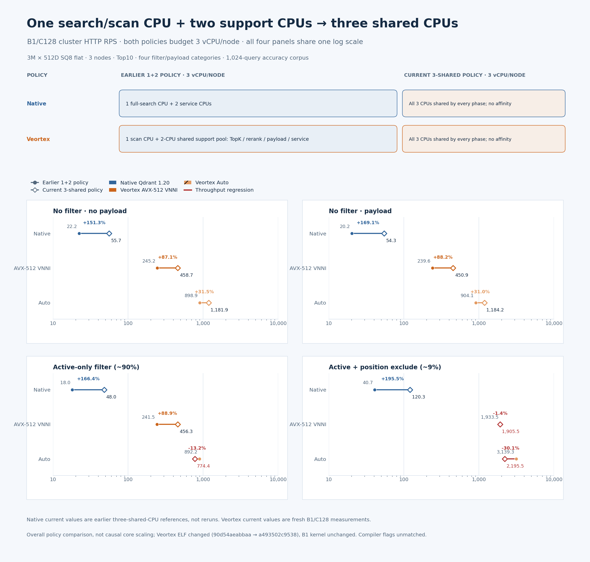
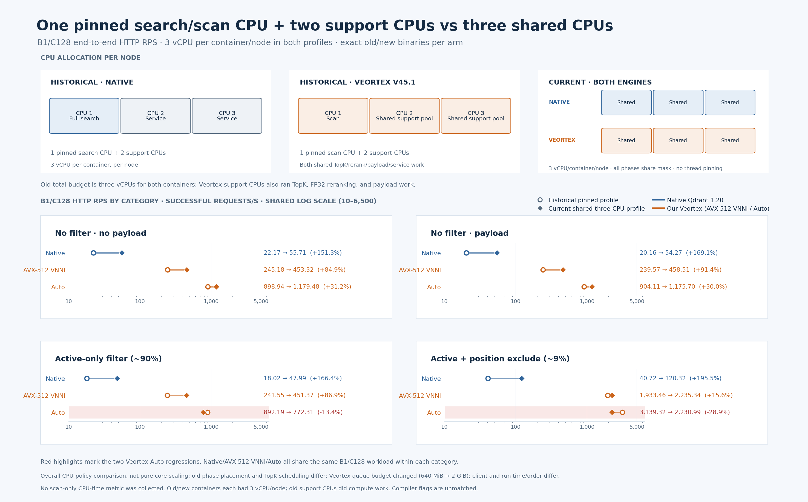
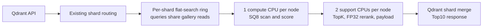

# Qdrant 1.20.0 with Veortex: a reproducible flat-search study

This repository publishes **binary-only research builds** of Qdrant 1.20.0 with Veortex flat-search kernels integrated into the Qdrant process. It is a study of how flat quantized search behaves when several queries share gallery reads under a fixed CPU budget. It does not claim that every query is faster or that a single isolated query has lower latency.

Qdrant remains the database and cluster manager: its API, WAL, shard routing, Raft, replication, and internal gRPC remain in use. Veortex is an in-process path for eligible flat quantized searches. There is no Veortex sidecar or separate Veortex cluster.

## Performance comparison

The chart uses recorded **SQ8 B1/C128** results: one query per HTTP request, 128 concurrent requests, ordered Top10, and three million vectors searched across the three-node cluster. All four request categories use the same dataset with metadata present. It also shows C1 context, where native was faster.


Read the [chart guide, data and reproduction commands](benchmarks/CHARTS.md), or download the [editable SVG](assets/benchmarks/sq8-b1-c128-comparison.svg). These are finite end-to-end observations with differing support-stage placement and unmatched compiler flags, not maximum-capacity or isolated kernel-speedup claims.

A separate [same-binary AVX-512 versus AMX follow-up](benchmarks/sq8-avx512-vs-amx-20261110.md) keeps the ring active and disables AMX. At SQ8 B1/C128, no filter/no payload measured **245.18 HTTP RPS with AVX-512 VNNI**, versus **898.94 with AMX-eligible Auto**. All eight filter/payload cells passed, with zero failed requests and ordered Top10 matching FP32. This V45.1 follow-up uses the same 640 MiB queue budget in both arms; it does not replace the earlier V45 matrix.

### Revision note — 10 November 2026 (WIB): CPU fairness
<!-- CPU_FAIRNESS_B1_LATEST_START -->

**CPU policy comparison at B1/C128:** each policy budgets three vCPUs per node. The earlier policy assigned one full-search CPU to Native, or one scan CPU to Veortex, with two CPUs available for support work; the current policy exposes all three CPUs to all phases without per-thread affinity.

| Engine | Earlier 1+2 policy | Current three-shared policy |
|---|---|---|
| Native Qdrant 1.20 | 1 full-search CPU + 2 service CPUs; 3 vCPU total | All 3 CPUs shared by search and service; no per-thread affinity |
| Veortex AVX-512 VNNI / Auto | 1 scan CPU + 2 CPUs in a shared TopK/rerank/payload/service pool; 3 vCPU total | All 3 CPUs shared by every phase; no per-thread affinity |



Each cell shows **earlier 1+2-policy HTTP RPS → current 3-shared-policy HTTP RPS (percent change)**. All panels use one global logarithmic axis; red marks throughput regressions. At B1, HTTP RPS equals query/s.

| Workload | Native Qdrant 1.20 | Veortex AVX-512 VNNI | Veortex Auto |
|---|---:|---:|---:|
| No filter, no payload | 22.2 → 55.7 (+151.3%) | 245.2 → 458.7 (+87.1%) | 898.9 → 1181.9 (+31.5%) |
| No filter, payload | 20.2 → 54.3 (+169.1%) | 239.6 → 450.9 (+88.2%) | 904.1 → 1184.2 (+31.0%) |
| Active-only filter (~90% eligible), payload | 18.0 → 48.0 (+166.4%) | 241.5 → 456.3 (+88.9%) | 892.2 → 774.4 (-13.2%) |
| Active + position + exclusion (~9% eligible), payload | 40.7 → 120.3 (+195.5%) | 1933.5 → 1905.5 (-1.4%) | 3139.3 → 2195.5 (-30.1%) |

The policy comparison reuses the earlier three-CPU Native values (not rerun) and compares historical 1+2-policy rows with the latest B1/C128 observations. The current Veortex candidate is source commit `1bd74d911fa8c61f962d5b22fbd4ac2951102a80` (ELF SHA-256 `a493502c9538e10e66637993432e1d619c13004368c78c423f9041ff6be3d607`); its binary differs from the historical Veortex policy binary, while the B1 kernel path itself is unchanged. Native's current comparison values are also a prior three-shared-CPU reference, not a new measurement. These are overall policy comparisons, not causal core-scaling results; compiler flags remain unmatched. The historical CPU observer records role/affinity activity only, so no old whole-process CPU aggregate is inferred.
The changes are mixed: each red-marked throughput decline remains an open optimization item, and the available comparison does not establish its cause. Preserve the gains while isolating admission wait, ring wait, scan, TopK/reranking, payload completion, and cross-node join costs.

For Veortex, this also changes pipeline scheduling: the earlier profile used `QDRANT_VEORTEX_SEPARATE_TOPK=1`, whereas these shared-CPU runs used `0`. Separating TopK into other workers and assigning those workers exclusive CPUs are different choices, but the tested implementation couples them. Thus these measurements do not isolate affinity, worker count, or stage separation individually.

**Current shared-CPU B1 load matrix:** all three CPUs per node were shared across server phases with no per-thread affinity. The Native values are prior three-CPU references and were not rerun; Veortex AVX-512 VNNI and Auto values are fresh candidate measurements.

Each cell below is **HTTP RPS / full-response p95 / p99 milliseconds**. Native cells are historical three-shared-CPU references.

| Workload | Concurrency | Native Qdrant 1.20 (earlier run) | Veortex AVX-512 VNNI (fresh) | Veortex Auto (fresh) |
|---|---:|---:|---:|---:|
| No filter, no payload | B1/C64 | 55.43 / 1546.88 / 1881.56 | 242.39 / 274.73 / 282.52 | 640.75 / 110.54 / 130.56 |
| No filter, no payload | B1/C128 | 55.71 / 2461.91 / 2854.50 | 458.72 / 291.95 / 305.12 | 1181.85 / 122.24 / 133.51 |
| No filter, payload | B1/C64 | 54.08 / 1375.51 / 1662.05 | 235.07 / 278.27 / 400.48 | 618.34 / 114.37 / 122.60 |
| No filter, payload | B1/C128 | 54.27 / 2899.84 / 3734.77 | 450.86 / 300.60 / 316.08 | 1184.24 / 118.99 / 128.45 |
| Active-only filter (~90% eligible), payload | B1/C64 | 50.23 / 1386.95 / 1677.05 | 237.91 / 286.99 / 303.38 | 423.67 / 157.07 / 163.43 |
| Active-only filter (~90% eligible), payload | B1/C128 | 47.99 / 2974.24 / 3420.46 | 456.35 / 295.33 / 306.00 | 774.41 / 182.10 / 253.82 |
| Active + position + exclusion (~9% eligible), payload | B1/C64 | 119.30 / 601.67 / 669.96 | 970.30 / 76.95 / 84.91 | 1155.87 / 64.61 / 69.29 |
| Active + position + exclusion (~9% eligible), payload | B1/C128 | 120.32 / 1261.05 / 1473.20 | 1905.54 / 88.94 / 98.53 | 2195.52 / 78.73 / 88.57 |

The workload uses **3M × 512D SQ8 flat search**, three nodes, Top10, metadata in all four categories, and the same fixed **1,024-query corpus**. Each timed dispatch ran for 60 seconds followed by client drain. Across the 16 accepted fresh Veortex rows, **788,981 successful HTTP requests** produced **788,981 timed queries**, all **788,981** matching ordered Top10 IDs from FP32 truth, with score tolerance 1e-6. All eight independent accuracy checks passed 1,024/1,024; the original containers were restored healthy and immutable lower metadata was unchanged.

The candidate is source commit `1bd74d911fa8c61f962d5b22fbd4ac2951102a80` (ELF SHA-256 `a493502c9538e10e66637993432e1d619c13004368c78c423f9041ff6be3d607`). The B1 singleton search path is unchanged by the multi-query batch-admission change, so these new B1 load points do not demonstrate a B1 kernel optimization. The finite end-to-end observations are not maximum-capacity results.

Read the [one-versus-three policy report](benchmarks/cpu-policy-1-vs-3-20261110.json), the [full B1 report](benchmarks/ring-b1-c64-c128-20261110.md), [B1 JSON evidence](benchmarks/ring-b1-c64-c128-20261110.json), and [B1 CSV](benchmarks/ring-b1-c64-c128-20261110.csv). The [B1/C64 and B1/C128 head-to-head figure](assets/benchmarks/cpu-fairness-b1-latest-20261110.png) is available alongside the policy figure. Policy assets: [SVG](assets/benchmarks/cpu-fairness-b1-policy-latest-20261110.svg), [plotted CSV](assets/benchmarks/cpu-fairness-b1-policy-latest-20261110.csv), [provenance manifest](assets/benchmarks/cpu-fairness-b1-policy-latest-20261110.manifest.json); B1 assets: [SVG](assets/benchmarks/cpu-fairness-b1-latest-20261110.svg), [plotted CSV](assets/benchmarks/cpu-fairness-b1-latest-20261110.csv), [provenance manifest](assets/benchmarks/cpu-fairness-b1-latest-20261110.manifest.json), and [renderer](reproduce/render-cpu-fairness-b1-latest.py).

<!-- CPU_FAIRNESS_B1_LATEST_END -->

<details>
<summary>Historical CPU allocation/B1/C128 revision</summary>


The original measurements and sections below are retained. **Equal container quota did not mean equal CPU allocation within the search pipeline.** The published native profile set `max_search_threads=1` and used an external preload to pin native search workers, including scan, TopK, and FP32 rescoring, to one CPU. Its other two CPUs handled service work. Veortex used one CPU for scan/score and the other two for TopK, rescoring, and payload completion. This allocation difference is also identified in [Qdrant's tracking issue #11462](https://github.com/qdrant/qdrant/issues/11462). The historical speedups include that scheduling difference; disabling AMX alone does not remove it.

**Revision addition — allocation table and completed follow-up:** both profiles had three total vCPUs per node. The change was which phases could use those CPUs.

| Profile | Container budget per node | Search and support placement |
|---|---:|---|
| Historical native | 3 vCPU | One CPU for full search; two CPUs for service work |
| Historical Veortex V45.1 | 3 vCPU | One CPU for scan; both support CPUs shared TopK, FP32 reranking, payload, and service work |
| Current native and Veortex | 3 vCPU | All phases share the full three-CPU mask; no per-thread affinity |



The following table compares **B1/C128** on the same three-million-vector SQ8 fixture, with Top10 per query and metadata present in every category. Each cell is **historical HTTP RPS → shared-three-CPU HTTP RPS (change)**. Each engine/mode pair uses the same binary before and after; this remains an overall CPU-policy comparison, with changes to scheduling and campaign conditions, rather than isolated scan-only scaling.

| Workload | Native Qdrant 1.20 | Veortex AVX-512 VNNI | Veortex Auto |
|---|---:|---:|---:|
| No filter, no payload | 22.17 → 55.71 (+151.3%) | 245.18 → 453.32 (+84.9%) | 898.94 → 1,179.48 (+31.2%) |
| No filter, payload | 20.16 → 54.27 (+169.1%) | 239.57 → 458.51 (+91.4%) | 904.11 → 1,175.70 (+30.0%) |
| Active-only (~90% eligible), payload | 18.02 → 47.99 (+166.4%) | 241.55 → 451.37 (+86.9%) | 892.19 → 772.31 (−13.4%) |
| Active + position + exclusion (~9% eligible), payload | 40.72 → 120.32 (+195.5%) | 1,933.46 → 2,235.34 (+15.6%) | 3,139.32 → 2,230.99 (−28.9%) |

The figure uses a shared **logarithmic HTTP RPS scale**. Red highlights preserve the two Auto regressions. Read the [full CPU-policy comparison, including p95/p99](benchmarks/cpu-policy-1-vs-3-20261110.md), [SVG](assets/benchmarks/cpu-fairness-20261110.svg), [plotted CSV](assets/benchmarks/cpu-fairness-20261110.csv), [provenance manifest](assets/benchmarks/cpu-fairness-20261110.manifest.json), or [renderer](reproduce/render-cpu-fairness.py). Native compiler flags remain unmatched; no new benchmark was run to create this figure.

**Historical launch status, retained for context:**

A new comparison is being measured with **all three CPUs shared by search and service work on each node**, no per-thread affinity, and disjoint Docker CPU sets. Native uses three search threads; Veortex allows three unpinned ring workers and disables the dedicated 1+2 split. The requested cells are B1/C64, B1/C128, B64/C4, and B128/C4. Native, Veortex AVX-512, and Veortex Auto are measured afresh. No result from that pending campaign is claimed here yet. See the [shared-CPU reproduction profiles](reproduce/README.veortex.md#revision-note--10-november-2026-wib-shared-three-cpu-profile).

**Live report:** [shared three-CPU results](benchmarks/shared3-live-20261110.md), with [JSON evidence](benchmarks/shared3-live-20261110.json) and [CSV](benchmarks/shared3-live-20261110.csv), is updated after each recorded measurement. The report distinguishes accepted rows, rejected rows, and incomplete cleanup; it does not replace the historical tables below.

**Revision clarification — B128 routing:** the tested Veortex binary sends compatible explicit batches of up to 64 queries into the circular ring. B128 uses its direct batched path, split into groups of up to 96 queries. Therefore B64 and B128 measure different existing execution paths; B128 support in the benchmark client does not add B128 ring admission to the engine. Every returned query still has the same Top10/FP32 correctness contract and shared three-CPU limit.

**Open implementation gap — dynamic batch admission:** the intended design admits compatible queries from every supported request batch size into the same bounded ring queue. A B128 request should enqueue its 128 queries, admit them as active slots become free, and complete its response when all members finish. The 64-query active capacity should not select a separate execution path solely because a request contains more queries. This behavior is not implemented in the tested binary; queue-memory bounds, deadlines, cancellation, and update consistency must remain valid when it is added.

**Next requested stage:** compare 1, 2, and 3 local shards per node (3, 6, and 9 physical shards in the cluster), keeping total vector count and the same shared three-CPU limit per node. Dataset preparation and actual shard placement must be verified before publishing that comparison.

</details>

### Completion revision — 10 November 2026 (WIB): three shared CPUs

The pending status above records the campaign's launch; the campaign is now complete. **All 48/48 measurements were accepted**, with **880,743 successful HTTP requests, zero failed requests, and 2,425,707 timed queries** whose ordered Top10 matched the pinned FP32 truth. The independent prechecks passed **12 × 1,024 queries**. The original cluster was restored healthy and the immutable dataset layers were unchanged.

The table below shows **B1/C128**, with each cell reporting **HTTP RPS / p95 / p99 milliseconds**. All three CPUs per node were available to every server thread, with disjoint node CPU sets and no per-thread affinity.

| Workload | Native Qdrant 1.20 | Veortex AVX-512 VNNI, AMX off | Veortex Auto, AMX observed |
|---|---:|---:|---:|
| No filter, no payload | 55.71 / 2,461.91 / 2,854.50 | 453.32 / 293.98 / 301.96 | 1,179.48 / 120.30 / 134.03 |
| No filter, payload | 54.27 / 2,899.84 / 3,734.77 | 458.51 / 296.13 / 302.48 | 1,175.70 / 121.10 / 132.50 |
| Active-only (~90% eligible), payload | 47.99 / 2,974.24 / 3,420.46 | 451.37 / 295.64 / 329.96 | 772.31 / 181.55 / 200.56 |
| Active + position + subject exclusion (~9% eligible), payload | 120.32 / 1,261.05 / 1,473.20 | 2,235.34 / 82.92 / 95.34 | 2,230.99 / 78.26 / 86.84 |

The [complete 48-row report](benchmarks/shared3-native-veortex-20261110.md), [JSON evidence](benchmarks/shared3-native-veortex-20261110.json), and [CSV](benchmarks/shared3-native-veortex-20261110.csv) include B1/C64, B1/C128, B64/C4, B128/C4, all four categories, and actual per-node CPU use. HTTP RPS and query/s are separate for explicit batches. These are selected load points, not maximum-capacity or scan-only scaling measurements. Three available CPUs do not establish three saturated scan workers; compiler flags remain unmatched and the arms ran once in a fixed order.

The shared-CPU policy has mixed results against the previous 1-scan-plus-2-support policy. Auto B1/C128 active-only falls from 892.19 to 772.31 RPS, and the narrower filter falls from 3,139.32 to 2,230.99 RPS, while the two unfiltered categories improve. These regressions remain open optimization items. All older sections, tables, and images are retained as historical measurements under their stated configuration.

The [CPU-policy comparison](benchmarks/cpu-policy-1-vs-3-20261110.md), [JSON](benchmarks/cpu-policy-1-vs-3-20261110.json), and [CSV](benchmarks/cpu-policy-1-vs-3-20261110.csv) pair 20 primary and four supplemental measurements at the same B/C and filter/payload category. Both old and new profiles had three total vCPUs per node. The table reports gains and regressions, p95/p99, exact binary pins, and actual CPU use where measured. A near-3× scan-only gain remains a separate target to verify; these end-to-end results do not measure it.

### Validation revision — 10 November 2026 (WIB): B128 now uses the ring

The implementation gap recorded above applies to the earlier V45.1 binary. Candidate source `1bd74d911` removes the batch-size-only bypass: compatible explicit batches enqueue individual query members in the bounded ring, while each ring worker retains its 64-query active capacity. Capacity errors propagate without waiting behind an earlier unfinished member, and successful responses preserve query order. Focused tests passed 11 cases across eight groups, including B128/B200/B1000, mixed owners, cancellation, capacity rejection, and writer ordering.

**Fresh runtime validation:** all 16 cells passed on the same 3M × 512D SQ8 fixture, three Docker nodes, disjoint shared three-CPU masks, no per-thread affinity, and C4. All metadata was present in every category. The eight independent prechecks passed 8 × 1,024 queries; 18,315 timed HTTP requests completed without errors and all 1,617,536 timed queries matched ordered Top10/FP32 truth. Exact per-node submitted/completed counters proved every measured query entered the ring, with zero fallback or HNSW searches.

Each cell below is **cluster query/s / whole-response p95 / p99 ms**. An HTTP request contains B queries; HTTP RPS is query/s divided by B and is listed separately in the full report. Unfiltered queries search all three million vectors; filter rows use the stated eligible fraction.

| Workload | B/C | AVX-512 VNNI, AMX off | Auto, AMX observed |
|---|---:|---:|---:|
| No filter, no payload | 64/4 | 680.00 / 394.57 / 406.50 | 1,680.82 / 177.01 / 186.25 |
| No filter, no payload | 128/4 | 729.62 / 792.20 / 829.06 | 2,011.34 / 296.36 / 320.28 |
| No filter, payload | 64/4 | 669.94 / 406.09 / 416.52 | 1,606.80 / 172.26 / 179.05 |
| No filter, payload | 128/4 | 715.03 / 805.45 / 867.66 | 1,857.73 / 314.71 / 334.88 |
| Active-only (~90% eligible), payload | 64/4 | 667.78 / 410.32 / 495.51 | 1,131.82 / 246.26 / 255.76 |
| Active-only (~90% eligible), payload | 128/4 | 713.89 / 819.31 / 848.79 | 1,310.41 / 437.70 / 467.69 |
| Active + position + exclusion (~9% eligible), payload | 64/4 | 2,612.66 / 110.11 / 118.84 | 3,046.10 / 96.09 / 104.87 |
| Active + position + exclusion (~9% eligible), payload | 128/4 | 3,410.03 / 184.94 / 200.58 | 4,054.58 / 152.13 / 166.58 |

Against the matched prior three-CPU results, B128 throughput increased **26.9–80.7%**; B64 varied **−2.9% to +1.2%**. This is a selected end-to-end batch comparison with unchanged scoring kernels, not a maximum-capacity or isolated core-scaling result. The earlier B1/C128 filter regressions remain open; the deferred shard comparison has not been run.

The initial attempt retained six accepted rows and one CPU-attribution rejection. The shared observer discarded sub-jiffy thread runtime; observer v2 now validates scheduler-runtime interval evidence without adding it to utilization or increasing read cadence. After 24 offline observer/validator cases passed, all 16 final cells were measured afresh. Read the [sampling remediation archive](benchmarks/dynamic-ring-batches-initial-sampling-20261110.md).

Read the [complete prior/current comparison with HTTP RPS and p95/p99](benchmarks/dynamic-ring-batches-20261110.md), [JSON evidence](benchmarks/dynamic-ring-batches-20261110.json), or [CSV](benchmarks/dynamic-ring-batches-20261110.csv). Native rows there are clearly labeled references from the previous campaign; native was not rerun. The candidate ELF is SHA-pinned in the report and is **not yet part of the V45.1 download below**. Original containers were restored healthy and immutable dataset layers were unchanged.

## Download the research binary

The [V45.1 admission-budget release](https://github.com/nicabreon/qdrant-veortex-releases/releases/tag/v1.20.0-veortex.v45.1.20261109) adds an opt-in queue-byte ceiling of **2 GiB**, with the default still **384 MiB**. Its tested B64/C4 profile uses **640 MiB** and completed all four categories without HTTP 429s. It requires the [new environment example](configs/admission-budget-node0.env.example). Its executable SHA-256 is `90d54aeabbaa17350b94161f6a7926528b13452b0b50296f0bc45fc0e96969e0`; see the [manifest](releases/admission-budget-20261109-manifest.json).

The original frozen V45 binary remains available for reproducing the primary 80-row campaign:

Download the Linux x86_64 release archive from the [V45 release page](https://github.com/nicabreon/qdrant-veortex-releases/releases/tag/v1.20.0-veortex.v45.20261109). The executable requires glibc 2.34 or later. Verify the executable after extracting it:

```sh
sha256sum /opt/qdrant-veortex/bin/qdrant
```

Expected SHA-256: `9a44f09da70af7921da7b2a6893b98c1ea3d9dcab61986d3504b63f4e3dfa0e8`.

Release provenance: Qdrant source commit `bc0eec0015771e8c59134b1b83a740418efcff7e`, source tree `f3335fe4f9474c3bbc5274785c4bde930fc272be`.

See [manual deployment](DEPLOYMENT.md) for host checks, CA trust, configuration, TLS, API access, backups, and the reference CPU profile. The public repository contains reproduction helpers and notices, but does not include Qdrant or Veortex engine source.

## Which builds and accelerators are compared?

**The native baseline is the official downloaded Qdrant 1.20.0 GNU executable, not a locally rebuilt upstream binary.** Its release-archive digest was verified against the official asset. Veortex V45 and V45.1 were built locally from pinned source. Embedded ELF metadata identifies Rust **1.99.1 / LLD 23.1.1** for native and Rust **1.98.0 / LLD 22.1.8** for Veortex. The complete effective compiler flags of the official executable have not been recovered or matched.

Both source trees specify release **fat LTO** and **one codegen unit**. Our build used `cargo build --release --locked --offline -j 2`, optimization level 3, and no debug information. Those settings do not establish build equivalence: compiler versions differ, and upstream's effective environment overrides remain unknown.

Native Qdrant already has SIMD, including **AVX-512 VNNI and AVX-VNNI for SQ8**, and separate SIMD paths for TurboQuant. Veortex adds **AMX INT8 and a shared-read multi-query ring for eligible SQ8/TQ2/TQ4 flat searches**, with SIMD fallbacks. Turbo8/Turbo16 retain their upstream paths in these releases; they are not covered by that ring. Supported ISA is not the same as the ISA executed on every request.

See [build flags, their meaning, and the per-path CPU acceleration comparison](benchmarks/BUILD_FLAGS_AND_CPU_ACCELERATION.md), with [machine-readable provenance](benchmarks/build-provenance-20261109.json). This is an end-to-end binary comparison with disclosed build and stage-placement differences, not a controlled attribution of the measured gain to one optimization.

## What the test measures

The fresh comparison runs stock Qdrant 1.20.0 and the frozen Veortex V45 binary on a synthetic flat-search workload:

- A 3,000,000-vector, 512-dimensional normalized FP32 Gaussian gallery, split into three one-million-point shards with numeric point IDs.
- Synthetic ABIS-shaped metadata on all points. It is generated test data, not biometric data and not derived from people or fingerprints.
- A fixed 1,024-query corpus, SHA-256 `90c486e454c29d3145ae220447defc0eaca8b3c828d7fededa8b76ee43a77111`, using a named `gallery` vector and cosine distance.
- SQ8 quantized flat search with HNSW disabled, candidate cap 12 per segment, oversampling 1.2, then FP32 reranking to return ordered Top10 results. This is not an exhaustive full-precision scan of all three million vectors.
- Four request categories: no filter/no payload; no filter/with payload; active-only (about 90% eligible); and active plus `left_index` position with one subject excluded (about 9% eligible). Those percentages describe filter eligibility, not recall.

Before timing, each engine passed 4,096 exact-search checks: all 1,024 queries in each of the four categories. The timed client then validates every ordered Top10 ID, each score within `1e-6` of the exact FP32 truth, and the payload contract. The exact query vectors and truth are tied to the recorded manifest hashes.

The workload varies batch size **B** (queries per HTTP request) and concurrency **C** (in-flight HTTP requests): B1 at C1, 4, 32, 64, 128, and 160; and B4, B16, B32, and B64 at C4. The complete plan has 40 rows per engine and 80 total.

## Search path and CPU budget

The intended Veortex path groups eligible searches in a per-shard ring so concurrent queries can share gallery reads. The simplified flow is:



All nodes had a three-vCPU container quota. Veortex placed scan and score work on one designated compute CPU and support stages such as TopK, FP32 reranking, and payload completion on two support CPUs. The stock native search closure, including scoring, TopK, and reranking, ran on its one designated compute CPU; the other two CPUs remained available for support and service work. This is an end-to-end comparison under a matched three-vCPU budget, not a kernel-only comparison. Compiler-flag provenance is not matched between the upstream native binary and V45.

The following diagram focuses on one shard: compatible requests enter a bounded query ring, reuse gallery tiles, and complete through the support pipeline. The illustrated slots show how queries can join and finish independently.


[Short explanation for discussion](benchmarks/RING_SCHEDULING.md) · [PNG](assets/architecture/continuous-query-ring.png) · [SVG](assets/architecture/continuous-query-ring.svg)

The measurement VM reported an Intel Xeon Silver 4510, 16 guest vCPUs, 47.04 GiB RAM, KVM, and AVX2, AVX-512F, AVX-512 VNNI, AMX tile, and AMX INT8 features. Three Docker nodes shared that VM:

| Node | Three-vCPU cpuset | Compute CPU | Support CPUs |
|---|---|---:|---|
| 0 | `4,5,6` | `4` | `5,6` |
| 1 | `7,8,9` | `7` | `8,9` |
| 2 | `10,11,12` | `10` | `11,12` |

The client used CPUs `0,1,2,3,13,14,15`. These are guest-reported properties: physical-core isolation and physical cache topology were not established. Memory bandwidth and network capacity were not measured. The [final JSON report](benchmarks/h2h-sq8-batch-20261109.json) preserves row-level runtime observations.

## Results

The completed campaign contains all **80 scheduled rows**; **78 were accepted** by the row validators. The table below reports B1/C1 and B1/C128. Each cell shows **successful HTTP requests per second / full-response p95 milliseconds**. At B1, HTTP RPS and query-vector QPS have the same numeric value.

| Workload | C1 native | C1 V45 | C128 native | C128 V45 |
|---|---:|---:|---:|---:|
| No filter, no payload | 20.56 / 50.83 ms | 18.96 / 55.76 ms | 22.17 / 7,585.02 ms | 902.33 / 173.22 ms |
| No filter, payload | 19.85 / 52.16 ms | 19.08 / 56.43 ms | 20.16 / 9,682.57 ms | 1,008.27 / 171.72 ms |
| Active-only (~90% eligible), payload | 17.56 / 58.67 ms | 15.85 / 69.28 ms | 18.02 / 9,800.18 ms | 958.59 / 168.55 ms |
| Active + position + subject exclusion (~9% eligible), payload | 36.50 / 30.41 ms | 24.17 / 47.97 ms | 40.72 / 4,761.38 ms | 2,557.91 / 79.47 ms |

In these B1 rows V45 has lower throughput and higher p95 at C1 in all four categories; at C128 the accepted V45 rows have higher throughput and lower p95 in all four. That pattern is consistent with the ring's intended sharing under concurrency, but this comparison does not isolate that mechanism or establish a universal speedup. The C128 p95 values are under closed-loop load, not isolated-request latency or an SLA; the run does not establish maximum capacity.

The two rejected rows are filtered V45 B64/C4 (rows 75–76), which returned 5,969 and 5,211 HTTP 429 responses. The unfiltered B64/C4 rows on both engines had zero failed requests. Across responses that returned results, the client reported no Top10 ID, score, or payload mismatches, and there were no transport timeouts. The failed rows remain in the complete data. Their runtime logs include `Flat TQ2 circular ring admission capacity exceeded`; a separate diagnostic confirmed query-byte reservation exhaustion on all three nodes. See the [failure diagnosis and bounded-memory remediation](benchmarks/ADMISSION_REMEDIATION.md). For rows with failures, reported latency percentiles include all attempts, including HTTP 429 responses, and are not success-only percentiles.

Read the [English results report](benchmarks/h2h-sq8-batch-20261109.md), [80-row CSV](benchmarks/h2h-sq8-batch-20261109.csv), or [JSON with runtime evidence](benchmarks/h2h-sq8-batch-20261109.json). The CSV and JSON preserve row-level throughput, latency, validation, binary, client, and manifest hashes.

## B64/C4 admission remediation

The V45.1 follow-up changes the configurable reservation ceiling and tests a 640 MiB profile. **5,412/5,412 HTTP batches succeeded**, covering **346,368/346,368 timed queries with ordered Top10 IDs matching FP32**, with zero admission rejections on all three nodes. The original 384 MiB profile and failed rows remain in the primary raw evidence.

| Workload | HTTP RPS | Query/s | Full-batch p95 / p99 ms |
|---|---:|---:|---:|
| No filter, no payload | 15.59 | 997.60 | 307.46 / 320.49 |
| No filter, payload | 13.98 | 894.44 | 342.98 / 354.04 |
| Active-only (~90% eligible), payload | 15.18 | 971.73 | 317.63 / 330.22 |
| Active + position + exclusion (~9% eligible), payload | 45.25 | 2,895.74 | 110.04 / 121.89 |

These are **B64/C4**, so query/s is not HTTP requests/s. The source is `a1a2af190`, and the scan algorithm is unchanged. B1 was not remeasured for this follow-up. The unfiltered observations are about 3–5% below the earlier B64/C4 values, so these finite runs do not establish a no-regression or maximum-capacity claim. Read the [follow-up results and reused native baseline](benchmarks/h2h-sq8-admission-remediation-20261109.md) and [failure diagnosis](benchmarks/ADMISSION_REMEDIATION.md).

## Concurrency and explicit batches


Upper panels report **HTTP RPS at B1**; lower panels report **query/s at C4**, where each batch contains B queries. All Our B64 points use the successful **V45.1 admission remediation** with a 640 MiB queue cap, shown as separate diamonds. Native B64 measurements are reused from the primary campaign; they were not rerun for the follow-up. Other Our points use V45. The original failed rows remain archived in the primary evidence.

Download the [SVG](assets/benchmarks/sq8-concurrency-and-batch.svg), [80 accepted chart measurements as CSV](assets/benchmarks/chart-data-20261109.csv), or [provenance manifest](assets/benchmarks/chart-manifest-20261109.json).

## Measurement method and limits

The same frozen Go client was used across both arms and every batch size: executable SHA-256 `9dab9e7f2292d6b3ccae108335317b2f249cf0e83a7cada02650060c91b9c251`. Engine order alternated by B/C block, and each arm used its own copy-on-write data copy. Each row uses 16 successful validated HTTP warm-up requests, then a 60-second dispatch window and drains in-flight requests. Throughput counts successful fully validated HTTP requests and uses actual elapsed time including drain; full-response latency includes reading and validating the response. On rows with failures, latency percentiles include failed attempts such as HTTP 429, not only successful responses. The 60-second request timeout is a client failure bound, not a latency target. At B1 the 16-request warm-up covers 16 queries; at B64 it covers all 1,024 queries. Warm-up is not a guarantee of exhaustive cache priming; cache state can differ across recorded restarts.

These results support conclusions only about the accepted rows, this synthetic corpus, these filters, SQ8 cap, Top10 contract, CPU placement, builds, and run window. They do not establish maximum RPS, long-duration stability, production capacity, behavior on other hosts, universal recall, or a pure kernel speedup. Historical TQ2/TQ4 measurements are separate; their throughput-parity target against SQ8 was not met in that cohort. The head-to-head matrix is SQ8 only.

## Reproduce and inspect

- [Benchmark protocol and paired run order](reproduce/BATCH_MATRIX_PROTOCOL.md)
- [Reproduction and deployment guide](reproduce/README.md)
- [One-arm batch-matrix runner](reproduce/run-batch-matrix.py)
- [Veortex V45 environment profile](reproduce/README.veortex.md)
- [Build provenance and CPU acceleration](benchmarks/BUILD_FLAGS_AND_CPU_ACCELERATION.md)
- [Earlier V45 SQ8/TQ2/TQ4 results](benchmarks/historical-v45-20261102.md)
- [Separate stock Qdrant 1.20 baseline](benchmarks/native120-20261109.md)

The public generator uses seed `20261109` by default for a distributionally similar synthetic gallery. The original historical fixture seed is unknown, so regeneration does not recreate the old gallery bytes, rankings, or performance results. The original query corpus and manifests are identified by their hashes in the benchmark records.

## Provenance and license scope

| Component | Source commit | Binary SHA-256 |
|---|---|---|
| Stock Qdrant 1.20.0 baseline | `222b2e44ab1c3f17e8246396ead6558e45041df7` | `5081acd073ef29701415dc2d1655d98750be8c08008541febc20cf2935800f2f` |
| Qdrant–Veortex V45 release | `bc0eec0015771e8c59134b1b83a740418efcff7e` | `9a44f09da70af7921da7b2a6893b98c1ea3d9dcab61986d3504b63f4e3dfa0e8` |

[`LICENSE`](LICENSE) contains Apache-2.0 terms for Qdrant and the external benchmark/reproduction helpers; [`NOTICE`](NOTICE) identifies their component scope. This does not assign a standalone license to Veortex source or grant rights to engine source that is not included. The owner authorized redistribution of this specific Veortex-containing binary. See [third-party notices](third_party/THIRD_PARTY_NOTICES.md), the [license audit manifest](third_party/license-audit.json), and the [colored 3.1.1 MPL-2.0 source availability record](third_party/SOURCE-AVAILABILITY.md) for dependency terms.
