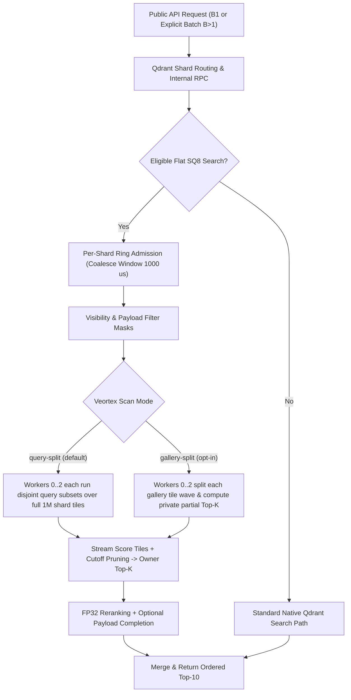

# Qdrant 1.20.0 with Veortex: Shared-CPU Flat Quantized Vector Search

This repository publishes **binary-only research builds** of Qdrant 1.20.0 integrated with Veortex in-process flat quantized search kernels, alongside reproducible benchmark runners, runtime profiles, and verified head-to-head results.

---

## What is Qdrant + Veortex?

**Qdrant + Veortex is not a separate vector database or an external sidecar.** Qdrant remains the database and cluster manager in full: its HTTP/gRPC API, collections, shard routing, Raft consensus, WAL, replication, payload indexes, filtering semantics, snapshot/recovery lifecycle, and storage formats stay intact inside a single `qdrant` binary.

Veortex acts as an **in-process execution engine** for eligible flat quantized searches (`exact=false` quantized flat scan + FP32 rescore, with HNSW disabled):

- Any non-flat or ineligible query routes automatically through standard Qdrant execution.
- No vectors are duplicated on disk and no second storage engine is maintained.
- Cooperative gallery scanning adds zero persistent storage overhead; it only changes how scan workers share memory reads and partial Top-K state during execution.

| Layer | Native Qdrant 1.20.0 (`222b2e44`) | Qdrant + Veortex (`afbe2437b`) |
|---|---|---|
| **Database & cluster** | Standard Qdrant storage, Raft, WAL, shard routing | Identical — Qdrant owns all state, routing, and API |
| **Request scheduling** | Independent per-request search; `BatchFilteredSearcher` shares reads within a single explicit `B>1` batch | Per-shard coalescing ring (`query-split`) or cooperative tile workers (`gallery-split`) sharing gallery reads *across* concurrent HTTP requests and batches |
| **Quantized scoring** | Upstream scalar/SIMD scorers | Cache-tiled multi-query kernels (`Auto`: Intel AMX + AVX-512 VNNI) |
| **Top-K, rescore & payload** | Sequential search closure on search threads | Streaming score tiles to owner-keyed Top-K with conservative cutoff pruning, FP32 reranking, and overlapped payload completion (`SEPARATE_TOPK=1`) |
| **CPU budget (benchmark contract)** | 3 shared vCPUs per node, no per-thread pinning | Same 3 shared vCPUs per node (`NanoCpus=3e9`), no per-thread pinning |

---

## Execution Modes & Request Flow

### Query-Split vs Gallery-Split

Suppose a shard holds **1,000,000 gallery vectors** on a node with **3 scan workers** sharing 3 vCPUs:

1. **`veortex_query` (`query-split`, default):**
   - Incoming concurrent `B1` requests and explicit batches join active lanes in the per-shard ring. Each worker takes a group of compatible queries and scans the shard's gallery tiles once across all queries in that group simultaneously.
   - **Strength:** At moderate-to-high concurrency (`C16–C512`), workers operate largely independently without inter-worker Top-K merge overhead per tile, achieving maximum memory-bandwidth amortization across dozens of concurrent queries.
2. **`veortex_gallery` (`gallery-split`, `QDRANT_VEORTEX_SCAN_MODE=gallery`, `WORKERS=3`, `PRIVATE_TOPK=1`):**
   - Cooperative scan workers (`veortex-scan-0..2`) divide each visible gallery tile wave across all 3 workers, accumulate partial candidates in worker-private Top-K buffers, and merge into the query owner's Top-K before FP32 reranking.
   - **Expected trade-off:** Aims to reduce per-request latency and parallelize scans across all 3 workers even when few concurrent query groups are active (low concurrency / small batches), while incurring worker coordination and private Top-K merge overhead as request concurrency climbs.

### Why Veortex Scales Higher Than Native Qdrant Here

In flat (non-HNSW) quantized search over 1M vectors per shard, **reading quantized vectors from RAM/L3 dominates execution time**:

- **Independent `B1` memory bottleneck in Native:** Concurrent `B1` requests trigger independent scans that repeatedly stream the same 1M vectors through CPU memory bandwidth and saturate 3 shared vCPUs (~`54–57` req/s unfiltered plateau, pushing C512 p99 latency above `10 s`).
- **Cross-request coalescing + multi-query kernels in Veortex:** By grouping compatible concurrent queries in the ring, each gallery tile fetched into L1/L2 cache scores multiple queries in one pass using dense multi-query AVX-512 VNNI or Intel AMX matrix instructions, while conservative Top-K cutoff pruning skips unnecessary work and separate Top-K/FP32-rerank/payload threads overlap remaining stages.
- **Trade-off at isolated C1:** With only `concurrency=1`, there are no concurrent requests to coalesce across HTTP connections, so Native's direct path can slightly lead Veortex's ring/coalescing handoff (`19.64` vs `17.15` req/s unfiltered).

---

## Latest Benchmark Campaign — 16 November 2026 (`COMPLETED`: `135/135` B1 Cells)

> **Primary B1 Matrix Status:** **`COMPLETED`** — `135/135` accepted cells (`45/45` `native_120`, `45/45` `veortex_query`, `45/45` `veortex_gallery`), `15/15 × 1,024` FP32 accuracy checks passed, **2,646,517** successful HTTP requests, `0` failed requests, `0` rejected cells, and all overlay/container restoration checks verified.  
> **Follow-up `B > 1` Batch Matrix (`B2..B128` at `C4/C6`):** **`COMPLETED`** — `210/210` accepted cells (`70/70` `native_120`, `70/70` `veortex_query`, `70/70` `veortex_gallery`), `15/15 × 1,024` FP32 accuracy oracle checks passed, **294,817** HTTP requests / **5,442,466** verified query members (`0` failed requests, `0` capacity rejections, all restoration checks verified). Full report: [benchmarks/native-query-gallery-batch-20261116.md](benchmarks/native-query-gallery-batch-20261116.md).

- **Full 135-Cell Report (All 5 Categories × C1–C512):** [benchmarks/native-query-gallery-20261116.md](benchmarks/native-query-gallery-20261116.md) ([JSON](benchmarks/native-query-gallery-20261116.json) | [CSV](benchmarks/native-query-gallery-20261116.csv))
- **Node Environment Profiles:** [Query-split profile](configs/query-gallery-query-20261116.env.example) | [Gallery-split profile](configs/query-gallery-gallery-20261116.env.example)
- **Binary Prerelease Download (`d2223c8a4` ELF):** [`v1.20.0-veortex.query-gallery.20261116`](https://github.com/nicabreon/qdrant-veortex-releases/releases/tag/v1.20.0-veortex.query-gallery.20261116) — `qdrant-veortex-query-gallery-1.20.0-linux-x86_64.tar.gz` (archive SHA-256 `da63b522b1dd0565bc48285d128a400926bacfb17f40849cab1059f2c82c7cbc`, unmodified `bin/qdrant` SHA-256 `d2223c8a48f9b65bcb59196d421fa00ded9488002975afc624990568be2be746`)

### Tested Arms & Binaries

| Arm | Executable SHA-256 | Source Commit | Mode / Config |
|---|---|---|---|
| **Native Qdrant 1.20.0** | `5081acd073ef29701415dc2d1655d98750be8c08008541febc20cf2935800f2f` | `222b2e44ab1c3f17e8246396ead6558e45041df7` | Native flat SQ8 + FP32 rescore (`MAX_SEARCH_THREADS=3`, `RAYON_NUM_THREADS=3`) |
| **Veortex `query-split`** | `d2223c8a48f9b65bcb59196d421fa00ded9488002975afc624990568be2be746` | `afbe2437b0ed3ddb533bfaae1c77d6bbc66d68c7` | Default ring (`MAX_RING_WORKERS=3`, `SEPARATE_TOPK=1`) |
| **Veortex `gallery-split`** | Same `d2223c8a4` ELF | `afbe2437b0ed3ddb533bfaae1c77d6bbc66d68c7` | Cooperative scan (`SCAN_MODE=gallery`, `WORKERS=3`, `PRIVATE_TOPK=1`) |

### Complete B1 Regime Comparison (`135/135` Accepted, `0` Failed, `0` Rejected)

Each cell reports **HTTP req/s; p95 / p99 ms** (`30s` closed-loop dispatch + full drain, `16` warmups, exact FP32 oracle Top-10 match `<= 1e-6`, payload verified):

| Category | Load | Native 1.20 (`native_120`) | Veortex `query-split` (`veortex_query`) | Veortex `gallery-split` (`veortex_gallery`) |
|---|---:|---:|---:|---:|
| **No filter / no payload** | C1 | 19.64; 57.11 / 78.69 | 17.15; 67.03 / 85.35 | **24.07**; 43.66 / 44.80 |
| **No filter / no payload** | C4 | 56.13; 95.30 / 105.64 | 65.07; 77.06 / 90.24 | **85.71**; 50.10 / 51.52 |
| **No filter / no payload** | C16 | 56.97; 326.79 / 395.98 | 259.97; 71.60 / 82.99 | **313.27**; 55.46 / 58.58 |
| **No filter / no payload** | C32 | 55.99; 658.49 / 787.06 | 482.81; 81.03 / 96.49 | **509.19**; 68.26 / 72.71 |
| **No filter / no payload** | C64 | 55.46; 1,281.58 / 1,573.56 | **787.14**; 97.50 / 113.77 | 711.00; 101.98 / 114.67 |
| **No filter / no payload** | C512 | 54.71; 10,626.71 / 11,130.64 | **2,052.28**; 343.91 / 395.04 | 1,593.89; 386.19 / 407.53 |
| **Payload only** | C1 | 19.72; 52.76 / 69.69 | 18.32; 59.70 / 72.53 | **24.25**; 43.44 / 44.65 |
| **Payload only** | C16 | 56.04; 358.59 / 447.15 | 268.51; 66.31 / 83.19 | **299.76**; 58.01 / 61.09 |
| **Payload only** | C512 | 54.01; 9,828.86 / 13,944.50 | **1,828.83**; 420.93 / 468.93 | 1,540.67; 408.91 / 445.41 |
| **Active ~90% / no payload** | C1 | 17.35; 61.34 / 75.86 | 15.21; 73.50 / 95.16 | **18.86**; 59.01 / 64.57 |
| **Active ~90% / no payload** | C64 | 50.51; 1,511.06 / 1,709.36 | 708.84; 104.44 / 120.33 | **709.18**; 100.93 / 107.09 |
| **Active ~90% / no payload** | C512 | 48.78; 12,477.39 / 12,805.77 | **1,926.19**; 414.00 / 506.74 | 1,644.70; 378.54 / 398.43 |
| **Active ~90% + payload** | C1 | 17.44; 62.03 / 84.58 | 15.22; 75.36 / 94.25 | **18.91**; 58.38 / 61.07 |
| **Active ~90% + payload** | C32 | 49.78; 703.05 / 942.42 | 429.32; 82.75 / 103.00 | **439.36**; 79.84 / 83.49 |
| **Active ~90% + payload** | C512 | 48.16; 11,105.92 / 12,572.95 | **1,799.65**; 422.24 / 473.47 | 1,550.10; 404.43 / 430.22 |
| **Active + pos + excl (~9%)** | C1 | **33.36**; 37.40 / 61.72 | 25.25; 45.44 / 48.99 | 18.66; 60.80 / 63.64 |
| **Active + pos + excl (~9%)** | C4 | **113.54**; 46.53 / 51.09 | 93.09; 50.15 / 54.64 | 71.97; 62.46 / 65.23 |
| **Active + pos + excl (~9%)** | C16 | 117.63; 172.60 / 202.31 | **354.20**; 52.65 / 54.84 | 277.52; 64.71 / 67.14 |
| **Active + pos + excl (~9%)** | C512 | 114.69; 4,595.74 / 5,094.40 | **3,126.79**; 259.83 / 335.94 | 2,539.88; 287.68 / 331.00 |

### What the Completed B1 Results Show

1. **Dense / Broad Scans (Unfiltered and ~90% Active Filter):**
   - **Low-to-moderate concurrency (`C1–C32`, and up to `C64` on 90% no-payload):** **`veortex_gallery` wins on both throughput and latency**, beating both Native 1.20 and `veortex_query` (e.g., `No filter / no payload` C1: `24.07` req/s with `44.80 ms` p99 vs Native `19.64` / `78.69 ms` and `veortex_query` `17.15` / `85.35 ms`; C16: `313.27` vs Native `56.97` and `veortex_query` `259.97`). Dividing visible gallery tiles across 3 cooperative workers avoids single-worker serialization on small query counts.
   - **High concurrency (`C64/C128–C512`):** **`veortex_query` achieves peak cluster throughput** (`2,052.28` req/s unfiltered C512, `1,799.65–1,926.19` req/s active ~90% C512 — **33.9×–39.5×** Native's `48.16–54.71` req/s plateau, with `p99` staying at `395–507 ms` vs Native's `11.1–13.9 s`). Once enough independent queries fill active ring lanes, letting workers scan full shard passes independently avoids inter-worker private Top-K merge overhead per tile wave.
2. **Highly Selective ~9% Filter (`Active + position + exclusion`):**
   - **Isolated `C1–C4`:** **Native leads** (`33.36` / `113.54` req/s vs `25.25` / `93.09` `query-split` and `18.66` / `71.97` `gallery-split`) because only ~9% of points pass the filter (~90K candidates/shard), so Native's direct scan completes rapidly without paying ring coalescing (`1000 us`) or splitting a smaller candidate stream across workers.
   - **`C16–C512`:** `veortex_query` overtakes Native and scales to **`3,126.79` req/s** (`p99 = 335.94 ms`) vs Native **`114.69` req/s** (`p99 = 5,094.40 ms`) — **27.3×** higher throughput, while `veortex_gallery` reaches `2,539.88` req/s.
3. **Practical Guidance:**
   - Choose **`veortex_gallery`** when workloads have low-to-moderate `B1` concurrency (`C1–C32`) over broad/unfiltered flat collections and tail latency matters most.
   - Choose **`veortex_query`** (default) when serving high concurrency (`C64–C512`) or narrow filtered traffic (`~9%` selectivity) for maximum cluster throughput.

All 135 cells (9 concurrency points × 5 categories × 3 arms) are recorded in [benchmarks/native-query-gallery-20261116.md](benchmarks/native-query-gallery-20261116.md).

### Follow-Up `B > 1` Explicit Batch Matrix (`COMPLETED`: `210/210` Accepted Cells, `0` Failed, `0` Rejected)

Under the identical 3 shared vCPUs/node contract (`MAX_SEARCH_THREADS=3`, `RAYON_NUM_THREADS=3`, zero per-thread pinning), explicit `/points/search/batch` tests (`B2, B4, B8, B16, B32, B64, B128` at `C4` and `C6`, reporting `HTTP req/s` and `query members/s` separately; every member of all `5,442,466` queries verified against saved truth and payload contract) completed **`210/210`** accepted cells across all 3 arms (`0` HTTP 429 capacity rejections). Full 210-cell report: [benchmarks/native-query-gallery-batch-20261116.md](benchmarks/native-query-gallery-batch-20261116.md) ([JSON](benchmarks/native-query-gallery-batch-20261116.json) | [CSV](benchmarks/native-query-gallery-batch-20261116.csv)).

Selected key regime cells across all 3 completed arms (`HTTP req/s / query q/s; p95 / p99 ms`):

| Category | Batch / C | Native 1.20 (`native_120`) | Veortex `query-split` (`veortex_query`) | Veortex `gallery-split` (`veortex_gallery`) |
|---|---|---:|---:|---:|
| **No filter / no payload** | B2 / C6 | 47.88 HTTP / **95.76** q/s; 139.62 / 165.32 | 102.02 HTTP / **204.04** q/s; 66.89 / 87.36 | **118.19** HTTP / **236.37** q/s; 54.23 / 56.86 |
| **No filter / no payload** | B8 / C6 | 26.71 HTTP / **213.66** q/s; 248.18 / 289.53 | 83.75 HTTP / **670.01** q/s; 84.79 / 102.99 | **89.14** HTTP / **713.15** q/s; 73.08 / 77.66 |
| **No filter / no payload** | B64 / C6 | 4.06 HTTP / **259.85** q/s; 1,535.72 / 1,616.97 | **38.81** HTTP / **2,484.13** q/s; 214.70 / 252.16 | 29.85 HTTP / **1,910.63** q/s; 235.59 / 257.26 |
| **No filter / no payload** | B128 / C6 | 2.04 HTTP / **261.70** q/s; 3,071.40 / 3,880.57 | **21.74** HTTP / **2,782.94** q/s; 344.12 / 393.89 | 15.68 HTTP / **2,007.18** q/s; 441.32 / 465.03 |
| **Payload only** | B8 / C4 | 25.86 HTTP / **206.86** q/s; 205.15 / 221.22 | 61.76 HTTP / **494.04** q/s; 72.93 / 90.37 | **66.69** HTTP / **533.50** q/s; 67.97 / 73.00 |
| **Payload only** | B128 / C6 | 1.99 HTTP / **254.23** q/s; 3,223.93 / 3,868.66 | **18.19** HTTP / **2,327.97** q/s; 401.30 / 431.84 | 14.49 HTTP / **1,854.19** q/s; 484.61 / 513.58 |
| **Active ~90% / no payload** | B16 / C4 | 16.02 HTTP / **256.38** q/s; 329.10 / 351.65 | 43.75 HTTP / **699.96** q/s; 102.63 / 124.58 | **45.25** HTTP / **724.00** q/s; 94.43 / 101.73 |
| **Active ~90% / no payload** | B128 / C6 | 2.00 HTTP / **255.44** q/s; 3,593.01 / 5,051.83 | **20.25** HTTP / **2,592.42** q/s; 378.74 / 416.99 | 15.19 HTTP / **1,944.69** q/s; 456.97 / 483.46 |
| **Active ~90% + payload** | B8 / C6 | 24.34 HTTP / **194.74** q/s; 266.69 / 312.06 | 69.14 HTTP / **553.09** q/s; 103.73 / 114.95 | **73.84** HTTP / **590.72** q/s; 87.29 / 91.14 |
| **Active ~90% + payload** | B128 / C6 | 1.96 HTTP / **250.53** q/s; 3,152.35 / 3,613.90 | **16.95** HTTP / **2,169.69** q/s; 448.82 / 482.38 | 13.73 HTTP / **1,758.01** q/s; 524.69 / 556.54 |
| **Active + pos + excl (~9%)** | B2 / C4 | **103.82** HTTP / **207.64** q/s; 53.60 / 56.91 | 89.82 HTTP / **179.65** q/s; 50.52 / 53.25 | 68.01 HTTP / **136.01** q/s; 66.48 / 130.73 |
| **Active + pos + excl (~9%)** | B64 / C6 | 13.77 HTTP / **881.58** q/s; 513.20 / 592.45 | **54.52** HTTP / **3,489.40** q/s; 139.07 / 151.42 | 48.81 HTTP / **3,124.11** q/s; 157.88 / 173.52 |
| **Active + pos + excl (~9%)** | B128 / C6 | 6.93 HTTP / **886.78** q/s; 1,003.23 / 1,055.07 | **34.20** HTTP / **4,377.67** q/s; 224.57 / 242.33 | 31.97 HTTP / **4,092.49** q/s; 243.12 / 266.19 |

**What the Completed `B > 1` Batch Matrix Shows:**
- **`veortex_gallery` leads `25/70` cells** (all `B2–B8` broad/unfiltered cells plus `B16/C4` on 90% active workloads), proving cooperative gallery-tile splitting consistently wins small-to-moderate batch fan-in even with explicit `/points/search/batch`.
- **`veortex_query` leads `43/70` cells**, reaching up to **`10.63×`** Native 1.20 (`2,782.94` vs `261.70` q/s on `B128/C6` unfiltered; `p99 393.89 ms` vs `3,880.57 ms`) and peaking at **`4,377.67` query/s** (`34.20` HTTP req/s, `p99 242.33 ms`) vs Native `886.78` query/s (`p99 1,055.07 ms`) on selective `~9%` `B128/C6` (`amx_calls` active across all 3 nodes).
- **`native_120` leads `2/70` cells** (`Active + pos + excl ~9%` at `B2/C4` `207.64` vs `179.65` q/s and `B4/C4` `363.20` vs `345.48` q/s) before `veortex_query` overtakes from `B2/C6`, `B4/C6`, and `B8–B128`.

---

<!-- BEGIN_TQ_CAMPAIGNS -->

## TurboQuant Head-to-Head Matrix (`TQ4` & `TQ2`, Same 345-Cell SQ8 Matrix)

Same cluster, binary (`d2223c8a4` vs Native 1.20.0 `5081acd0`), dataset (3M × 512D Cosine, `hnsw_m=0`), 5 payload/filter categories, and 3 shared guest vCPUs/node (`NanoCpus=3e9`, zero pinning) as the completed SQ8 campaign.

| Quantization | Status | Oversampling | Query Bytes | Accuracy Contract | B=1 Report | B > 1 Batch Report |
|---|---|---:|---:|---|---|---|
| **TQ4** (`turbo.bits4`) | `RUNNING` (`20` acc) | `4.0` | `1` | 100% exact FP32 Top-10 | [135/135 cells](benchmarks/tq4-query-gallery-20261116.md) ([JSON](benchmarks/tq4-query-gallery-20261116.json) / [CSV](benchmarks/tq4-query-gallery-20261116.csv)) | [31/210 cells](benchmarks/tq4-query-gallery-batch-20261116.md) ([JSON](benchmarks/tq4-query-gallery-batch-20261116.json) / [CSV](benchmarks/tq4-query-gallery-batch-20261116.csv)) |
| **TQ2** (`turbo.bits2`) | `PROBE_COMPLETED` (`15` acc) | `2.0` | `0` | 100% Native TQ2 parity + FP32 Recall@10 | [0/135 cells](benchmarks/tq2-query-gallery-20261116.md) ([JSON](benchmarks/tq2-query-gallery-20261116.json) / [CSV](benchmarks/tq2-query-gallery-20261116.csv)) | [0/210 cells](benchmarks/tq2-query-gallery-batch-20261116.md) ([JSON](benchmarks/tq2-query-gallery-batch-20261116.json) / [CSV](benchmarks/tq2-query-gallery-batch-20261116.csv)) |

<!-- END_TQ_CAMPAIGNS -->

## Fairness Contract & Limitations

- **Equal Guest Resources:** Three Docker nodes (`4,5,6`, `7,8,9`, `10,11,12`), `NanoCpus=3,000,000,000` (3 vCPUs/node), zero per-thread CPU pinning on any arm. Every scan, Top-K, rerank, payload, and HTTP thread shares the 3 node CPUs.
- **Unmatched Compiler Flags:** Official upstream Native Qdrant 1.20.0 (`5081acd0...`) vs local Rust 1.98 LTO release build (`d2223c8a4...`). Throughput differences include both algorithmic/scheduling differences and compiler/ISA differences.
- **Scope Caveats:** Measurements run on a shared KVM Xeon Silver 4510 VM over 3M × 512D SQ8 Cosine with `hnsw_m=0`, Top-10, 12-candidate rescore (`oversampling=1.2`), and finite 1,024-query/category cohorts (`15 × 1,024` accuracy gates passed pre-timing across all 3 arms). Results do not establish HNSW speedups, write-heavy throughput, or universal FP32 equivalence on unseen queries.

---

## Documentation, Reproduction & Archives

- **Architecture & Protocols:** [Qdrant Native vs Veortex](docs/QDRANT_NATIVE_VS_VEORTEX.md) | [Batch Matrix Protocol](reproduce/BATCH_MATRIX_PROTOCOL.md) | [Manual Deployment Guide](DEPLOYMENT.md) | [Reproduction Helpers](reproduce/README.md)
- **Prior Reports & Releases (Historical):** [11 Nov 2026 README Archive](README.archive-20261111.md) | [10 Nov 2026 README Archive](README.archive-20261110.md)
- **Licensing:** Binary research distribution only (Qdrant/Veortex engine source not included). See [LICENSE](LICENSE), [NOTICE](NOTICE), [third_party/THIRD_PARTY_NOTICES.md](third_party/THIRD_PARTY_NOTICES.md), [third_party/license-audit.json](third_party/license-audit.json), and [third_party/SOURCE-AVAILABILITY.md](third_party/SOURCE-AVAILABILITY.md).
