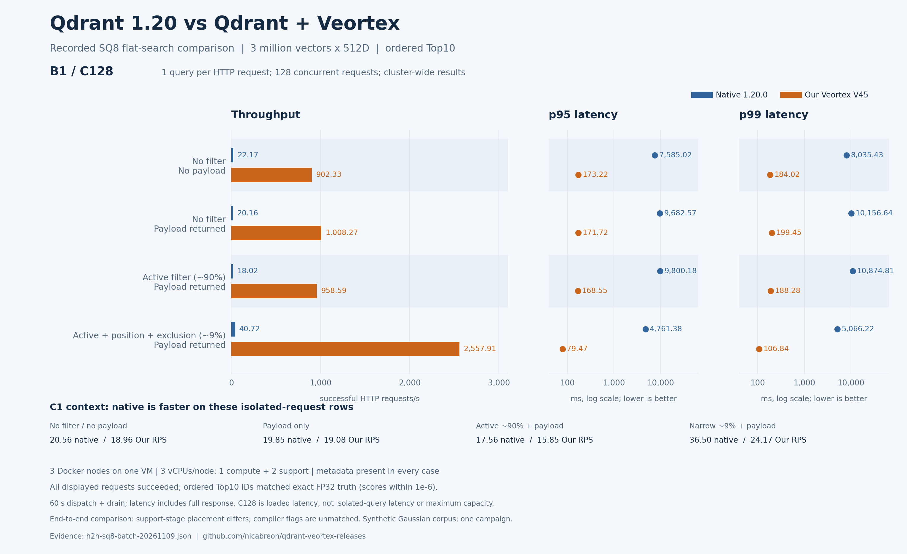
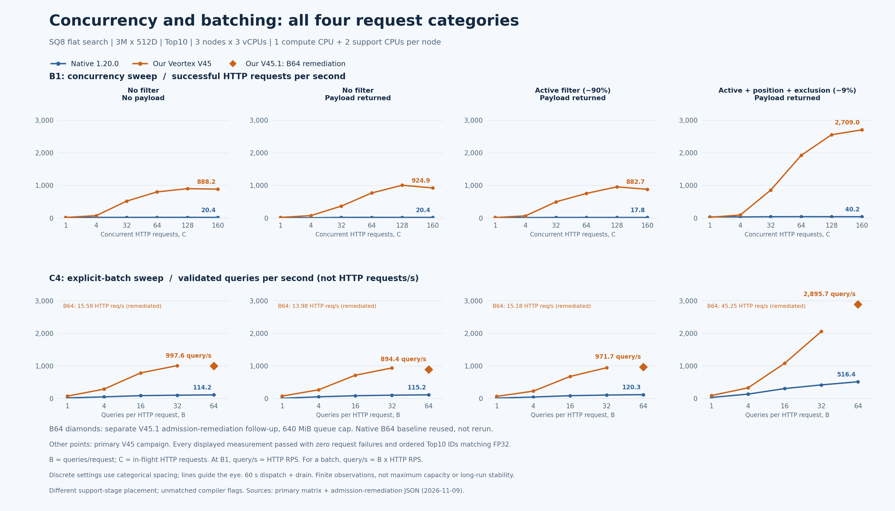

# Native Qdrant versus Qdrant + Veortex: recorded performance charts

These charts render existing evidence. No engine build, dataset load, or new benchmark was run to make them. All displayed measurements are accepted, have zero failed HTTP requests, and returned ordered Top10 IDs matching the fixed exact-FP32 truth, with score tolerance `1e-6`.

The workload is SQ8 flat search over **3,000,000 normalized Gaussian 512D vectors**, split into three one-million-point shards. Every point has synthetic metadata, including the no-payload category. Each request returns **Top10 per query**; **1,024** is the fixed query-corpus size. HNSW is disabled. SQ8 uses cap 12 candidates per segment and FP32 reranking. This is not an exhaustive FP32 scan of all gallery vectors.

## B1/C128: throughput and response latency



[PNG](../assets/benchmarks/sq8-b1-c128-comparison.png) · [SVG](../assets/benchmarks/sq8-b1-c128-comparison.svg)

Here **B1** is one query per HTTP request and **C128** is 128 concurrently in-flight HTTP requests. At B1, HTTP requests/s equals query/s. The throughput axis is linear; the latency dot plots use explicitly labeled logarithmic axes. Latency includes the complete response and client validation, under load.

| Category | Native HTTP RPS | Our V45 HTTP RPS | Native p95 / p99 ms | Our V45 p95 / p99 ms |
|---|---:|---:|---:|---:|
| No filter, no payload | 22.17 | 902.33 | 7,585.02 / 8,035.43 | 173.22 / 184.02 |
| No filter, payload | 20.16 | 1,008.27 | 9,682.57 / 10,156.64 | 171.72 / 199.45 |
| Active filter (~90% eligible), payload | 18.02 | 958.59 | 9,800.18 / 10,874.81 | 168.55 / 188.28 |
| Active + position + exclusion (~9% eligible), payload | 40.72 | 2,557.91 | 4,761.38 / 5,066.22 | 79.47 / 106.84 |

The percentages are filter eligibility, not recall. The same graphic includes the C1 throughput comparison: native was faster on all four isolated-request rows. C128 observations do not establish maximum capacity, an isolated-query latency, or an SLA.

## Concurrency and batch-size sweeps



[PNG](../assets/benchmarks/sq8-concurrency-and-batch.png) · [SVG](../assets/benchmarks/sq8-concurrency-and-batch.svg)

The upper row plots successful **HTTP requests/s** at B1 for C=1, 4, 32, 64, 128, 160. The lower row holds C4 and plots validated **queries/s** for B=1, 4, 16, 32, 64. For batches, `queries/s = B × successful HTTP requests/s`; 1,000 queries/s at B64 is about 15.6 HTTP requests/s. Settings use categorical spacing and connecting lines only guide the eye. All panels use the same linear vertical range, starting at zero.

### B64 uses the successful remediation

All four Our B64/C4 points are the separate **V45.1 admission-remediation follow-up**, marked with diamonds. The runtime queue-byte limit was **640 MiB/node**; its configurable maximum became 2 GiB and its unset default stayed 384 MiB. The scan algorithm did not change. Native B64/C4 values are the accepted **earlier primary-campaign baseline**, not a fresh native rerun. Our B1/B4/B16/B32 points remain V45; the V45 line stops at B32 rather than joining a different build's B64 point.

| Category | Native HTTP RPS | Native query/s | Our V45.1 HTTP RPS | Our V45.1 query/s | Our p95 / p99 ms |
|---|---:|---:|---:|---:|---:|
| No filter, no payload | 1.78 | 114.18 | 15.59 | 997.60 | 307.46 / 320.49 |
| No filter, payload | 1.80 | 115.17 | 13.98 | 894.44 | 342.98 / 354.04 |
| Active filter (~90% eligible), payload | 1.88 | 120.25 | 15.18 | 971.73 | 317.63 / 330.22 |
| Active + position + exclusion (~9% eligible), payload | 8.07 | 516.40 | 45.25 | 2,895.74 | 110.04 / 121.89 |

The [primary matrix](h2h-sq8-batch-20261109.md) retains its original measurements and rejected V45 B64 filtered rows as evidence. Their HTTP 429s were attributed to query-byte admission capacity; the [remediation report](h2h-sq8-admission-remediation-20261109.md) supplies the successful follow-up. The chart selection uses the four follow-up Our B64 rows, including the two unfiltered categories, consistently under the tested 640 MiB profile. It does not silently rewrite the frozen campaign.

## CPU allocation and interpretation

All three Docker nodes shared one KVM VM reporting a Xeon Silver 4510. Each node had three vCPUs: one designated compute CPU and two support CPUs. Native kept scoring, TopK, and FP32 rerank in its compute-CPU search closure. Veortex used the compute CPU for scan/score and the support CPUs for TopK, FP32 rerank, and payload completion. Physical-core isolation was not established.

The same frozen Go client, corpus, category contracts, candidate cap, and truth were used. Each row had 16 successful HTTP warm-ups, then 60 seconds of dispatch plus drain. Throughput is successful completed requests or queries divided by actual elapsed time including drain. Compiler versions and complete flags were not matched; see [build provenance and acceleration](BUILD_FLAGS_AND_CPU_ACCELERATION.md). This is a finite end-to-end comparison, not a controlled kernel-only attribution, universal recall proof, maximum-throughput claim, or long-duration stability test.

## Data and image reproduction

- [Chart CSV](../assets/benchmarks/chart-data-20261109.csv): 80 accepted measurements, each with its build, source file, row ordinal and source SHA-256. Four are V45.1 remediation rows; the other 76 are primary rows. p50/p95/p99, HTTP RPS and query/s are retained separately.
- [Chart manifest](../assets/benchmarks/chart-manifest-20261109.json): source hashes, units, selection policy, renderer versions and output hashes.
- [Primary JSON](h2h-sq8-batch-20261109.json) and [remediation JSON](h2h-sq8-admission-remediation-20261109.json): original evidence, unchanged.

Run from the repository root in a Python environment with the [chart dependencies](../reproduce/requirements-charts.txt):

```sh
python3 -m pip install -r reproduce/requirements-charts.txt
python3 reproduce/render-comparison-charts.py
```

The renderer reads those JSON files, validates acceptance and units, and writes PNG/SVG images plus the CSV and manifest under `assets/benchmarks/`. It makes no network calls and never starts a benchmark or Qdrant process. The plotted values come directly from JSON; chart titles, category labels and explanatory text are defined in the renderer. Matplotlib, not image generation, draws the quantitative graphics.
