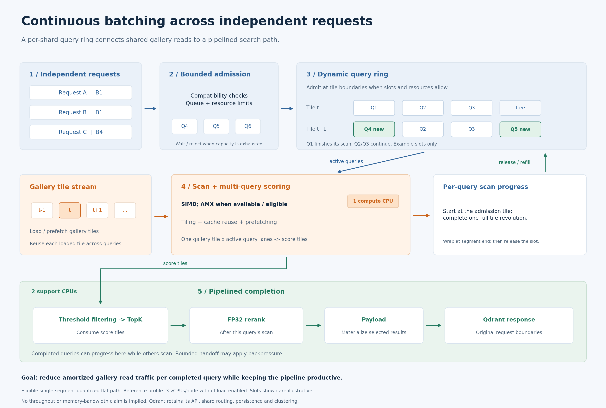

# Continuous batching across independent requests



[Download PNG](../assets/architecture/continuous-query-ring.png) · [Editable SVG](../assets/architecture/continuous-query-ring.svg)

## Short discussion text

Thanks for opening this tracking issue. One additional layer that might be worth tracking separately is **continuous batching across independent requests**, together with the surrounding memory-access and scheduling optimizations.

As noted in #11464, native Qdrant already shares chunk reads within explicit batches. I also explore that opportunity across independent requests through a per-shard query ring.

The ring groups compatible concurrent queries, including requests submitted individually as B1. Active queries share gallery tiles, and new queries can join at tile boundaries when slots become available, without waiting for the entire active group to finish.

The implementation combines several techniques:

- Cross-request batching and continuous ring scheduling.
- Shared gallery reads, cache-aware tiling, and prefetching.
- SIMD/AMX multi-query scoring kernels.
- Threshold filtering before TopK insertion and FP32 reranking.
- Pipelined scan, TopK, reranking, and payload completion, with bounded admission and backpressure.

The architectural goal is to **reduce amortized gallery-read traffic per completed query while keeping the scoring pipeline productive**.

## Reading the diagram

The four illustrated ring slots show a scheduling transition, not the real lane capacity or a mandatory batch size. A query starts at its admission tile and completes one full revolution of the segment's visible tiles, including wrap-around, before its scan slot is released. A request containing several queries retains its original response boundary. TopK consumes score tiles during the scan; FP32 reranking follows that query's scan completion. Bounded queues, worker leases, updates, or other resource limits can defer admission or completion.

The CPU labels show the reference **three-vCPU/node** placement with `QDRANT_VEORTEX_SEPARATE_TOPK=1` and configured support-CPU affinity. The released ring route requires an eligible quantized flat search over a single populated original segment; other cases follow the native route. AMX requires hardware/OS support and path eligibility. This is a conceptual diagram, not a measurement of memory bandwidth or a standalone speedup. See [build and path coverage](BUILD_FLAGS_AND_CPU_ACCELERATION.md), [benchmark charts](CHARTS.md), and the upstream [blocked-scoring proposal #11464](https://github.com/qdrant/qdrant/issues/11464).

## Recreate the image

Use the existing [chart dependencies](../reproduce/requirements-charts.txt), then run from the repository root:

```sh
python3 reproduce/render-ring-diagram.py
```

The renderer writes the PNG and SVG under `assets/architecture/`. It does not run a benchmark or change engine source.
