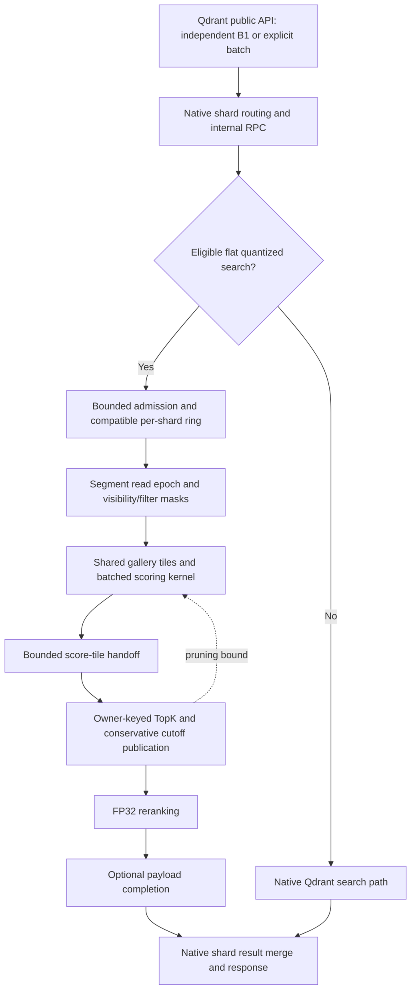

# Native Qdrant and Qdrant + Veortex: execution architecture

Revision: 11 November 2026 (WIB). This note describes the tested integration and
separates it from the cooperative gallery-scan candidate still being validated.
It is an architecture overview, not a claim that every Qdrant operation uses
Veortex or that the current downloadable release contains every experiment.

## The boundary between Qdrant and Veortex

Qdrant remains the database. Its API, shard routing, Raft, replication, WAL,
recovery, snapshot/transfer mechanisms, payload storage, and security remain the
foundation. The integration replaces or extends eligible search execution; it
does not import Veortex clustering or synchronize a second database through a
sidecar. The new cooperative scanner adds no persistent vector representation.

Here, **gallery** means the stored vectors being searched. A **query** is one
vector search. **B1** is one query per HTTP request; **B64** is 64 queries per
request. Query throughput and HTTP request throughput are equal only at B1.

| Layer | Native Qdrant reference | Qdrant + Veortex |
|---|---|---|
| Database and cluster | Qdrant storage and distributed database mechanisms | Retains Qdrant as the owner of data and cluster lifecycle |
| Request scheduling | Native search and explicit-batch execution | Adds a per-shard ring for compatible queries from independent B1 requests and explicit batches |
| Gallery reuse | Already processes chunks against multiple scorers within an explicit batch | Extends shared gallery tiles across compatible independent requests |
| Admission and completion | Native request/search controls | Adds bounded ring admission, active query lanes, per-query cancellation/completion, and backpressure |
| Quantized scoring | Native scorers and SIMD implementations | Adds format-specific multi-query kernels, including AVX-512 VNNI and AMX where supported |
| Memory access | Native storage layout and chunk access | Adds cache-aware tiling, query preparation/cache reuse, and prefetch scheduling |
| TopK and FP32 rescore | Native selection and rescoring pipeline | Streams score tiles to owner-keyed TopK consumers, then performs FP32 reranking |
| Filters and payload | Native payload indexes, filters, and result materialization | Uses Qdrant visibility/filter semantics; payload completion runs outside scan workers |
| CPU placement | Depends on the measured native configuration | Current shared-CPU profile lets scan, TopK, rerank, payload, and service threads use the same node CPU set |
| Cooperative gallery scan | Not the execution mode measured by our native reference | New opt-in candidate splits each visible gallery tile across a common node-wide scan pool; cluster diagnostic completed, candidate not promoted (revision below) |

The native reference is Qdrant 1.20 at commit
[`222b2e44`](https://github.com/qdrant/qdrant/commit/222b2e44ab1c3f17e8246396ead6558e45041df7).
Its [`BatchFilteredSearcher`](https://github.com/qdrant/qdrant/blob/222b2e44ab1c3f17e8246396ead6558e45041df7/lib/segment/src/index/hnsw_index/point_scorer.rs)
already iterates gallery chunks across the scorers of an explicit batch. It would
be incorrect to describe native Qdrant as always rereading the entire gallery
independently for every member of such a batch. This comparison is with that
pinned version and measured configuration, not every future upstream design.

## Request flow

New compatible queries can join at tile boundaries as lanes become available;
they do not have to wait for the whole active group to finish. Each query still
needs its own complete scan of the eligible gallery. A lane count is not the
maximum size of an HTTP batch: a larger request can queue members and admit them
as slots free, subject to memory/admission limits and cancellation.

TopK and reranking run on supporting threads, not on additional dedicated CPUs.
The current benchmark policy gives each node three shared vCPUs with no
per-thread affinity. The three nodes have disjoint CPU sets. Earlier 1+2 CPU
policies remain historical measurements and must not be mixed with this policy.

## Why SIMD/AMX alone does not explain the throughput difference

Several effects act together: cross-request batching, shared gallery reads,
cache tiling and prefetch, multi-query scoring, conservative threshold pruning,
and overlapped scan/TopK/rerank/payload stages. Their combined end-to-end effect
cannot be attributed to AMX alone or multiplied from separate microbenchmarks.
Disabling AMX keeps the ring and other scheduling optimizations in place; it is
an accelerator ablation, not a complete return to native Qdrant execution.

A pruning cutoff is the current conservative TopR boundary, not a blanket rule
that negative cosine scores are discarded. Equal scores must remain eligible
for the configured deterministic tie ordering. Reranking scores selected
candidates with FP32; the candidate budget is format/workload dependent. The
saved 1,024-query accuracy checks are finite evidence, not a proof of exactness
for every future query.

## Two ways to use multiple workers

For 96 total queries and one million gallery vectors on a node:

| Mode | Three-worker decomposition | Logical work |
|---|---|---|
| Query split | 32 queries per worker, each scanning the full gallery | The same 96 complete queries |
| Gallery split | All 96 queries against disjoint gallery portions | The same 96 complete queries |

The table describes equal-work decompositions, not a guarantee that the existing
ring admission distributes 96 arrivals as exactly 32/32/32. Its query mode
distributes owners dynamically between independent rings.

The existing independent-query ring mode and a new cooperative gallery mode are
separate execution choices. The gallery candidate divides visible bitmap tiles,
not persisted shards. Assignment can vary between tile waves; a worker is not a
new replica or a second copy of a million vectors. All gallery parts feed the
same TopR owner for a query before reranking, rather than retaining R/worker
candidates and losing potentially correct results.

The common scoring pool is bounded per node across rings, shards, and
collections. Scanner tasks join before lane mutation and before segment/read
locks can be released. Encoded queries and owner-bound pruning cutoffs are
shared; mutable counters and scratch belong to the executing worker. Visibility
still includes deletion, vector-deletion, mapping/shadowing, and filter masks.

## Implemented, measured, and planned

| Item | Status on this revision |
|---|---|
| Flat compatible TQ2/TQ4/SQ8 integration and cross-request ring | Implemented; scope and historical measurements are linked below |
| Shared-CPU scan/support pipeline | Measured in the latest completed cluster baseline, source `0aa62c28`, ELF `074f45...` |
| Cooperative gallery-scan adapter | Implemented in private candidate `085399a27`; focused checks and server build passed; eight cluster cells passed correctness, performance below the historical query-split baseline (revision below) |
| Automatic query/gallery selection | Planned calibration; the candidate's `auto` setting explicitly returns an error rather than claiming an autotuned policy |
| HNSW, sparse, multivector, and other operators using the common ring | Not established by these tests; separate adapters and validation are required |

The full scan benchmarks disable HNSW. They must not be presented as an HNSW
speedup. Likewise, native 2-bit encoding is not assumed to be identical to
standalone Veortex INT2; scoring must use the actual stored representation and
its score semantics.

## Reading the performance evidence

- [Latest completed shared-CPU cluster matrix](../benchmarks/worker-scaling-batch-concurrency-20261111.md): full 3M x 512D SQ8, three nodes, three shared CPUs per node, Top10, with filter/payload categories and accuracy/CPU gates.
- [Cooperative scorer component experiment](../benchmarks/single-shard-cooperative-scan-20261111.md): about 4,334 scan queries/s for the same 96 queries split over three workers' disjoint gallery parts. This excludes HTTP, TopK, FP32 reranking, payload, and cluster RPC.
- [Fixed-total 96-query experiment](../benchmarks/fixed-total96-worker-scaling-20261111.md): distinguishes fixed-work latency from a separate capacity experiment that assigned 96 queries to each of three workers (288 total).
- [CPU allocation and compiler caveats](../README.archive-20261110.md): records earlier CPU policies and unmatched native/custom compiler flags. Equal container quotas alone did not establish equal phase allocation.

Every query in the cluster fixture searches all three one-million-vector shards.
Cluster query/s is not the sum of three node rates for independently searchable
galleries. The requested target is at least 90% of an equivalent kernel-only
baseline; it is an optimization target, not a demonstrated cluster result.

The [README](../README.md) records the current downloadable-release distinction,
fixture metadata, saved-query reuse, unknown historical seed, and result tables.
No new cooperative-gallery RPS figure is claimed in this architecture note.

**Revision — 11 November 2026 (WIB):** The [cooperative gallery cluster diagnostic](../benchmarks/cooperative-gallery-ring-20261111.md) has completed. All eight cells passed the recorded correctness/CPU/route gates, with zero failed requests, but all eight were slower than the historical query-split counterparts. The adapter remains experimental. Its unbuilt scratch-reuse follow-up is backed up separately; further scheduler work is now isolated in a standalone laboratory rather than the Qdrant server.
